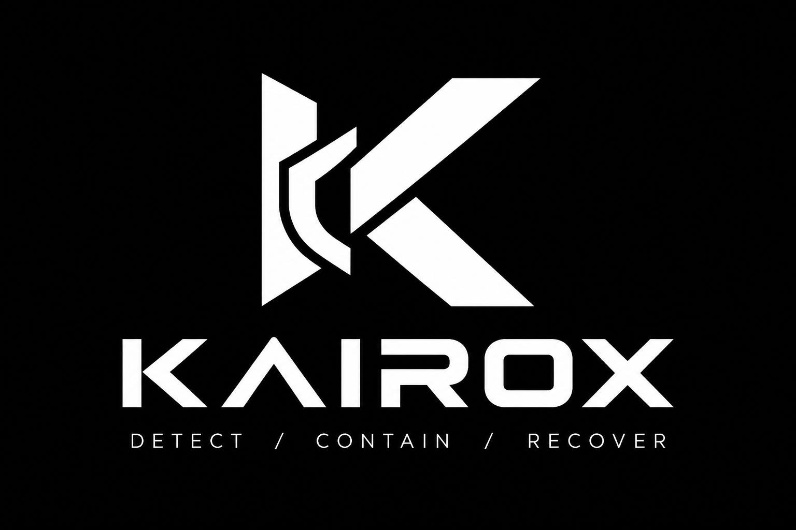
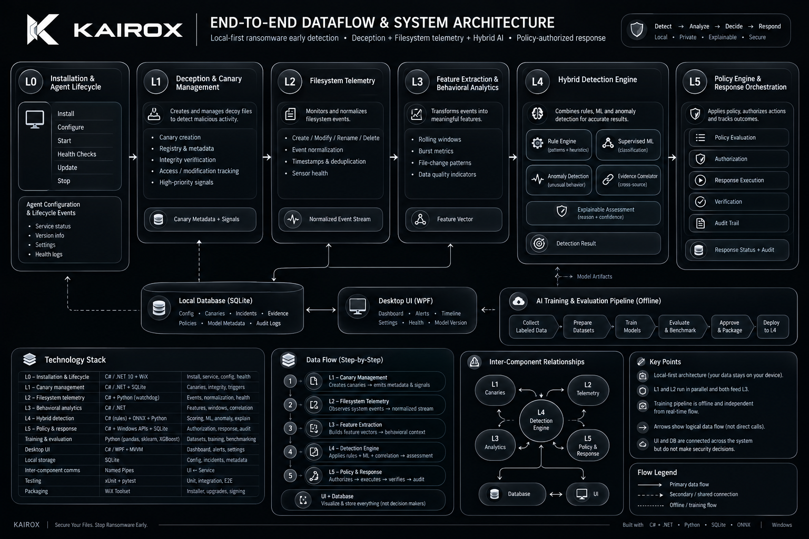
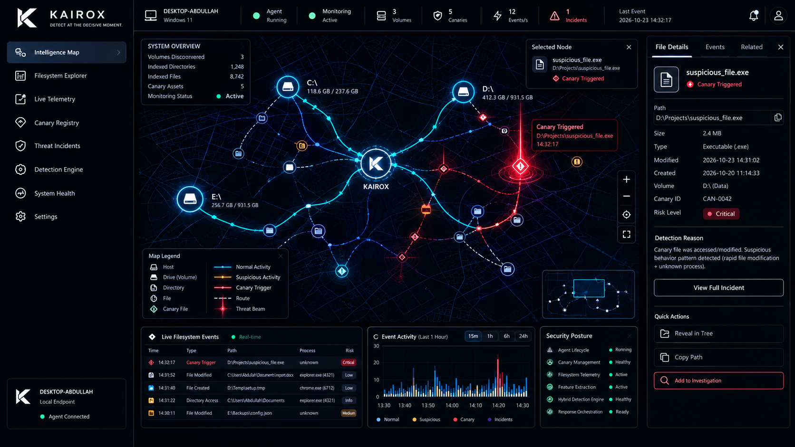
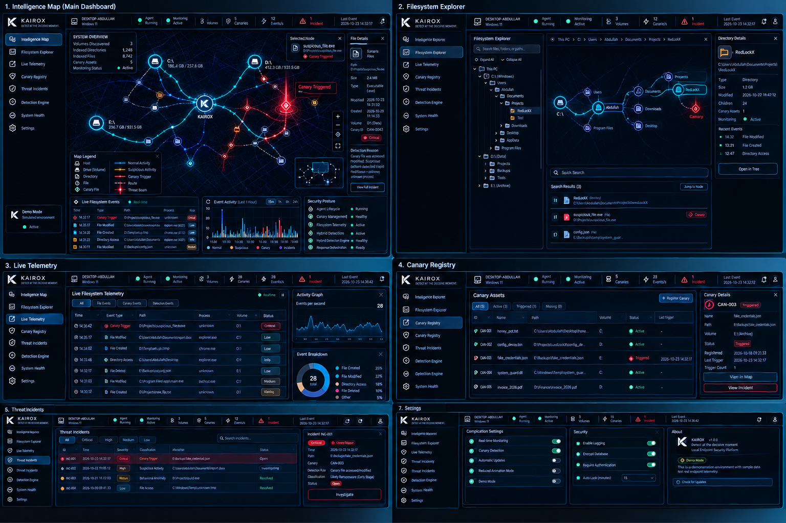

Inspired by Greek kairos (καιρός), the opportune or decisive moment.

Tagline: Detect at the decisive moment.

Fits the idea of catching ransomware early, at the moment a suspicious action reveals the attack.







# 1. The core product vision

KAIROX is a local-first, AI-assisted endpoint defense platform that detects ransomware-like behavior using multiple independent signals, then coordinates a controlled response.

Its defining innovation is the combination of:

- Deception: planted canary files that act as high-value tripwires.
- Behavioral detection: rapid file modification, renaming, deletion and suspicious write patterns.
- AI-assisted analysis: models that score event sequences rather than judging an isolated file event.
- Rapid response: alerting, process containment and recovery workflows.
- Forensic visibility: an evidence-backed timeline showing what happened, why it was flagged, and whether containment succeeded.

The critical engineering principle is that KAIROX should not depend on any single detector. A canary could be missed, a legitimate application could modify many files, and a machine-learning model could be wrong. The system needs multiple detection paths and a reliable policy engine.

# What makes it innovative?

The strongest pitch is not “we use AI to detect ransomware.” Many security products already do behavioral detection.

Instead, pitch KAIROX as:

> A deception-guided endpoint defense system that correlates high-confidence canary events with behavioral evidence to detect, explain and contain ransomware-like attacks at the earliest observable stage.
> 

That gives the judges a specific technical innovation they can evaluate.


Languages: C# + WPF

This layer makes KAIROX a real desktop product.

Responsibilities

- Install and register the KAIROX agent.
- Start the agent when the user enables protection.
- Track whether monitoring and detection are healthy.
- Manage configuration, model versions and upgrades.
- Keep the interface separate from the privileged protection service.

First Focus will be window 11/10

This is KAIROX's signature capability.

The canary manager **`creates decoys that resemble valuable files, but contain only synthetic data`**. Each canary is registered with a **unique identifier** and expected integrity information.

A canary(**fake file used as bait to detect ransomware or other suspicious file activity**) record could contain:

| Field | Simple meaning |
| --- | --- |
| `canary_id` | Unique ID for this particular fake file |
| `device_id` | Computer where it was created |
| `relative_path` | Its location, such as `Decoys/Financial_Report.xlsx` |
| `file_type` | Type of decoy file (db, sqli, exe, jpg, png, sh, exe, py, bat, bin, tmp etc) |
| `integrity_hash` | Fingerprint of its expected contents |
| `created_at` | When KAIROX created it |
| `status` | Whether it is active, triggered, missing or retired |
| `trigger_count` | Number of suspicious interactions recorded |

Why is `integrity_hash` important? KAIROX can compare a file's current contents with its expected fingerprint to detect changes. However, the hash alone cannot detect every access: KAIROX also needs file activity monitoring.

**How the engine works**

1. Select folders the user explicitly authorizes.
2. Generate decoy files with safe, synthetic content.
3. Register their expected paths and integrity fingerprints.
4. Validate that the canaries exist and can be monitored.
5. Track their lifecycle and flag unexpected changes.
6. Replace or retire canaries under controlled rules.

**Advanced feature:** canary health monitoring. KAIROX should distinguish between a canary that was accessed, one that was modified, one that was deleted, and one that simply disappeared because its folder was moved.

Those are different events and should have different evidence levels.
In simple words, filesystem telemetry means monitoring what happens to files and folders on a computer and recording those activities as events.

For KAIROX, think of it as a security camera for your computer's files. It watches for suspicious activity and reports what it observes.

The telemetry layer observes the filesystem and converts low-level notifications into structured events.

## Improved event schema

For the MVP, Python's `watchdog` is sufficient for monitoring selected directories. For stronger Windows coverage, plan a later integration with native Windows event sources.

We would use something like this for KAIROX:

`{
"event_id": "evt_example_001",
"device_id": "local-device",
"timestamp_utc": "2026-10-21T12:00:00Z",
"ingested_at_utc": "2026-10-21T12:00:00.015Z",
"sequence_number": 1842,
"event_type": "file_modified",
"path_id": "path_token_123",
"destination_path_id": null,
"is_canary": true,
"canary_id": "canary_007",
"process": {
"pid": null,
"identity_status": "unavailable",
"source": null
},
"sensor": {
"name": "filesystem_monitor",
"version": "0.1.0"
},
"integrity_status": "not_checked",
"event_quality": "observed",
"correlation_id": null
}`

| Issue | Improvement |
| --- | --- |
| `path_id`  | Use a stable file/path identifier or a privacy-preserving path token, with a secure mapping stored locally. |
| `process_id: null` | Add a process-attribution source and a reason when attribution is unavailable. |
| Duplicate events | Add a deduplication key and correlation window. |
| Lost notifications | Add watcher-health monitoring and periodic directory reconciliation. |
| Rename events | Record both source and destination paths. |
| Event timestamps | Store UTC timestamps and a separate ingestion timestamp. |
| No event ordering | Add a monotonic sequence number per monitoring source. |
| No event provenance | Record the sensor and its version. |
This layer is also very important for KAIROX. In simple words, it takes many individual file events and combines them to understand whether the overall behavior looks suspicious.

Think of it this way:

- L2: Filesystem telemetry: Watches files and records what happens.
- L3: Behavioral analysis: Looks at the collected events together to identify suspicious patterns.

| Feature | What it tells KAIROX |
| --- | --- |
| `distinct_files_modified` | How many different files changed |
| `rename_count` | How many rename operations occurred |
| `deletion_count` | How many deletion events were observed |
| `canary_trigger_count` | Whether decoy files were touched |
| `extension_diversity` | How many file types were affected |
| `write_burst_count` | Whether writes occurred in rapid bursts |
| `process_identity_confidence` | How reliable the process attribution is |
| `entropy_change_available` | Whether content entropy was measured and changed |

These features form a feature vector — essentially a list of numbers and indicators describing activity during a particular time window
In simple terms, this is the brain of your ransomware defense system. It combines rules, machine learning and evidence from earlier layers to decide how suspicious an activity is and what action should follow.

It receives normalized filesystem telemetry and behavioral features from Layers 2 and 3, evaluates suspicious activity through multiple independent detection mechanisms, correlates the available evidence, and produces an explainable risk assessment for the response policy engine.

KAIROX should not rely on a single machine-learning model. A model can misclassify legitimate activity, a canary can be triggered by an unexpected application, and filesystem telemetry can be incomplete. Combining these signals allows KAIROX to make better-informed decisions while explicitly accounting for uncertainty.

The defining principle is:

> Detect through multiple signals, decide through correlated evidence, and respond according to confidence and risk.
> 

The engine consists of five components:

1. Deterministic rule engine
2. Supervised machine-learning detector
3. Unsupervised anomaly detector
4. Evidence correlation and risk assessment
5. Policy decision interface

## Component A — Deterministic rule engine

The rule engine provides fast, explainable detection without waiting for machine-learning inference. It evaluates individual events and correlated patterns against explicitly defined conditions.

### Detection rules

| Rule | Trigger condition | Suggested significance |
| --- | --- | --- |
| R1: Canary interaction | Unexpected modification, rename or deletion of a registered canary | High-priority signal |
| R2: Canary lifecycle anomaly | A canary is rapidly modified and then renamed or deleted | Very high-priority signal |
| R3: File modification burst | Many distinct files change within a short interval | Depends on baseline and context |
| R4: Extension transformation | Numerous files are renamed with unusual extension changes | Suspicious behavioral signal |
| R5: Combined activity | File modification bursts coincide with deletion, renaming or a canary trigger | Stronger combined evidence |
| R6: Sensor degradation | Watcher errors, event overflow or missing monitoring coverage | Lower confidence in the assessment |

These rules should generate evidence records rather than independently declaring every suspicious event to be confirmed ransomware.

A canary interaction deserves prompt investigation, but legitimate backup, indexing or security software can occasionally interact with a decoy. KAIROX should distinguish a high-priority signal from a confirmed incident.

### Example rule output

```
{
  "rule_id": "R1",
  "evidence_type": "canary_interaction",
  "severity": "high",
  "reason": "Registered canary modified unexpectedly",
  "confidence": "high",
  "recommended_action": "investigate_and_correlate"
}
```

The values are illustrative. Rule severity and confidence should be validated against the system's expected workloads.

### Engineering requirements

- Evaluate critical rules immediately when events arrive.
- Deduplicate repeated notifications for the same underlying action.
- Associate related events with a shared incident or activity window.
- Store the rule ID, triggering evidence and rule version.
- Keep the rules configurable and testable independently of the ML model.

## 4. Component B — Supervised machine learning

The supervised detector estimates whether a behavioral feature vector resembles ransomware-like activity learned from labeled examples.

### Recommended model: LightGBM

LightGBM is the first candidate I would benchmark for KAIROX because the input is structured tabular data rather than raw file contents or images.

It can learn nonlinear relationships among features such as file modification rates, deletion bursts, extension diversity and canary activity. It is also a practical choice for relatively lightweight inference.

However, LightGBM is a candidate, not a guaranteed winner. KAIROX should retain Random Forest as a baseline and compare LightGBM against XGBoost before choosing the final model.

### Input features

The model receives features extracted by Layer 3.

| Feature | Description |
| --- | --- |
| `distinct_files_modified` | Number of unique files modified within the window |
| `rename_count` | Number of observed rename events |
| `deletion_count` | Number of observed deletion events |
| `extension_diversity` | Number of distinct affected extensions |
| `write_burst_count` | Number of detected bursts of write activity |
| `canary_trigger_count` | Number of distinct canary interactions |
| `process_identity_confidence` | Reliability of process attribution, when available |
| `telemetry_completeness` | Estimated completeness of observations |
| `window_duration_ms` | Duration of the behavioral window |

The training and inference pipelines must use the same feature definitions, order, units and missing-value conventions.

Important: Avoid including arbitrary identifiers such as `event_id` or `device_id` as predictive features. They can encourage the model to memorize the dataset rather than learn meaningful behavior.

### Output

The model returns a risk estimate, the model version and relevant inference metadata.

```
{
  "model_name": "kairox_lightgbm",
  "model_version": "0.1.0",
  "risk_score": 0.87,
  "inference_status": "success"
}
```

Here, `risk_score` is an illustrative normalized score, not a measured probability that ransomware is present.

### Training strategy

Use labeled, representative activity from:

- Normal document editing and application saves.
- Bulk file copies and moves.
- Backup and synchronization operations.
- Archive extraction and compression.
- Software installation and legitimate file updates.
- Harmless ransomware-like file-change simulations.
- Controlled tests involving decoy interactions.
- Benign high-volume workloads that can resemble malicious activity.

Separate training and test data by capture session, scenario or workload. Randomly splitting individual events from the same execution across both sets can inflate reported performance.

## 5. Component C — Unsupervised anomaly detection

### Recommended model: Isolation Forest

Isolation Forest can supplement the supervised detector by identifying behavioral windows that differ from the patterns represented in its reference data.

This is useful when KAIROX encounters an unusual activity pattern that was not explicitly represented in its labeled training examples.

For example, an unfamiliar application might modify many files in an unusual sequence. The anomaly detector can flag that activity for additional evaluation even if the supervised model does not assign it a particularly high risk score.

### Input and output

The detector can consume a selected subset of numerical behavioral features and return an anomaly score.

```
{
  "detector": "isolation_forest",
  "detector_version": "0.1.0",
  "anomaly_score": 0.78,
  "anomaly_detected": true
}
```

These values are illustrative. The meaning and direction of the raw score depend on the implementation and must be normalized consistently.

### Important limitations

- An anomaly is not necessarily malicious.
- A common ransomware pattern may not appear anomalous if the reference data is poorly selected.
- A baseline contaminated by malicious activity can weaken detection.
- Anomaly detection should not independently authorize destructive or disruptive actions.

Use Isolation Forest as supporting evidence rather than as a replacement for rules or supervised classification.

## 6. Component D — Evidence correlation and risk assessment

This is KAIROX's main opportunity for differentiation.

Rather than treating every model output independently, the correlation engine evaluates the available signals in context.

### Evidence considered

1. Deception evidence: Did a registered canary trigger, and was the interaction unexpected?
2. Behavioral evidence: Were numerous files modified, renamed or deleted within a short interval?
3. Process evidence: Is the responsible process identified, and how trustworthy is that attribution?
4. Model evidence: Do the supervised detector and anomaly detector indicate elevated risk?
5. Telemetry quality: Were notifications dropped, was monitoring interrupted, or is important context unavailable?
6. Temporal relationship: Did the signals occur within a relevant time window and appear to belong to the same activity?

### Evidence correlation example

Consider this illustrative observation:

| Signal | Observation |
| --- | --- |
| File activity | 86 distinct files modified in five seconds |
| Canary | One unexpected canary modification |
| Rename activity | Elevated |
| Process attribution | Unknown |
| LightGBM | Elevated risk estimate |
| Isolation Forest | Anomalous behavior |
| Telemetry health | No known monitoring gap |

The engine should classify this as a high-priority suspected ransomware incident, not as a proven infection. It should preserve the evidence, investigate available process metadata and pass the assessment to the policy engine.

If telemetry health is degraded, the engine should explicitly lower its confidence in the completeness of the assessment rather than treating missing evidence as evidence of safety.
The policy engine converts detection evidence into a permitted response. It should be a separate module, not a `process.kill()` call buried inside a machine-learning prediction function.

Recommend adding explicit states for conflicting evidence and failed response actions.

| Evidence or system state | Recommended response |
| --- | --- |
| Normal or low risk | Continue monitoring |
| Suspicious behavior | Increase permitted telemetry detail and record evidence |
| Unexpected canary trigger | Generate a high-priority alert and correlate related events |
| Strong, correlated attack evidence | Initiate the authorized containment workflow |
| Unknown or unreliable process identity | Preserve evidence and request intervention; avoid blind termination |
| Conflicting detector results | Continue observation or escalate according to policy |
| Monitoring failure | Display degraded protection status and record the failure |
| Containment failure | Raise an urgent alert, preserve the failure details and request intervention |
| Recovery required | Offer a separately authorized recovery workflow |

Important: A canary trigger should trigger urgent investigation, but it should not automatically authorize terminating an arbitrary process. You can configure a controlled, preapproved response for validated high-confidence scenarios.

## Process containment: make it verifiable

Your five-step process is a good foundation. I would formalize it as follows:

1. Detect: Receive a correlated incident assessment from Layer 4.
2. Validate: Resolve the process identity and verify that the process is associated with the suspicious activity.
3. Authorize: Check the applicable policy, action scope and approval requirements.
4. Execute: Submit the action to a dedicated response component with a timeout and a unique action ID.
5. Verify: Check the actual outcome and distinguish successful execution from a failed or inconclusive result.
6. Audit: Store the evidence, target identity, policy version, timestamps and response outcome.

On Windows, a PID alone is insufficient to identify a process reliably over time. KAIROX should validate process creation time and other available identity information to mitigate PID reuse. Parent-child relationships also need careful handling: terminating a parent does not necessarily stop all related processes.

For the MVP, restrict actual process termination to a known, harmless test simulator running in an isolated test environment.
## The AI training and evaluation pipeline

This is the part that can separate a technically credible project from an AI-themed adashboard.

KAIROX should have a repeatable pipeline that turns collected, labeled activity into a tested model artifact.

#### 01

Collect safe event traces

Normal workloads + controlled attack-like simulations

#### 02

Normalize and label

Session IDs, event types, labels and timestamps

#### 03

Extract versioned features

Rates, rename patterns, canary evidence and process metadata

#### 04

Train and validate

Random Forest baseline + scenario-separated test sets

#### 05

Evaluate and calibrate

Precision, recall, false positives, latency and calibration

#### 06

Package model artifact

Versioned model + feature schema + evaluation report

#### 07

Run locally

Inference inside the desktop agent; no cloud inference dependency

### What must the model predict?

Do not train a model that simply memorizes filenames or process names. The target should be whether an event window represents suspicious, ransomware-like activity under the labeling criteria.

Include benign bulk activity such as backups and archive extraction so that the model learns more than “many files changed quickly.”

### Metrics the judges should see

| Metric | Why it matters |
| --- | --- |
| Precision | How many alerts were actually positive in the evaluation set |
| Recall | How many positive attack-like scenarios were detected |
| False-positive rate | How often benign scenarios were flagged |
| Detection latency | Time from the first observable signal to detection |
| Containment latency | Time from the response decision to verified containment |
| Scenario coverage | How many distinct test scenarios were correctly handled |
| Resource overhead | CPU, memory and filesystem-monitoring impact |

Report measurements from actual test runs. Keep training and testing scenarios separate, and do not invent a 98% confidence score for presentation purposes.

### Make the AI explain itself

For each detection, display a concise evidence summary such as:

- A registered canary was modified.
- A burst of file modifications occurred.
- Extension changes were observed.
- Process attribution was unavailable.
- The behavioral model returned a risk score of `0.91`.

This is illustrative output. In the real application, each item must come from recorded evidence. The system should also show uncertainty and missing telemetry instead of hiding them.
#### Main focusing on

- Frontend: React + TypeScript + Tailwind CSS
- Desktop shell: Tauri 2 + Rust
- Detection engine: Python
- ML: scikit-learn
- Storage: SQLite
- Packaging: Tauri Windows installer + bundled Python agent

As its best for the Ui what we want…



====================================================

#### ***option: 02***

Based on the KAIROX architecture, the system has **six runtime layers (L0–L5)**, plus an offline AI training pipeline, desktop dashboard, local database, and shared communication layer. The following tables detail the programming languages, frameworks, libraries, internal components, data flow, and relationships between them.    Pasted text

## 1. Master Technology Stack

| Layer | Component | Primary Language | Framework / Technology | Main Responsibility |
| --- | --- | --- | --- | --- |
| L0 | Installation & Lifecycle | C# | .NET 10, Windows Service APIs | Install, configure, start, stop, monitor |
| L1 | Deception & Canary Management | C# | .NET, SQLite, filesystem APIs | Create and manage decoy files |
| L2 | Filesystem Telemetry | C# | .NET, Windows filesystem APIs | Monitor file operations |
| L3 | Behavioral Analytics | C# | .NET, in-memory queues | Extract behavioral features |
| L4 | Hybrid Detection Engine | C# + Python | Rules engine, ONNX Runtime, scikit-learn | Detect and assess suspicious behavior |
| L5 | Policy & Response | C# | .NET, Windows process APIs, SQLite | Authorize and coordinate responses |
| AI Training | Model Development | Python | pandas, NumPy, scikit-learn, LightGBM/XGBoost | Train and evaluate models |
| Desktop UI | User Interface | C# + XAML | WPF, MVVM, CommunityToolkit.Mvvm | Dashboard, alerts, incidents |
| Database | Persistent Storage | SQL | SQLite | Store configuration, evidence, incidents, audit records |
| IPC | Inter-Process Communication | C# | Authenticated Windows named pipes | Connect UI and protection service |
| Testing | Quality Assurance | C# + Python | xUnit, pytest | Unit, integration, ML, end-to-end tests |
| Installer | Packaging | Configuration / build tools | WiX Toolset | Install, upgrade, register the service |

**Architecture decision:** Use C#/.NET for the Windows protection runtime and Python for model development. Deploy compatible trained models into the C# service through ONNX Runtime when practical, avoiding a separate Python inference service in the initial design.    Pasted text

---

# 2. L0 — Desktop Installation & Agent Lifecycle

**Purpose:** Manage installation, configuration, startup, service health, and shutdown.

| Internal Component | Programming Language | Technology / Library | Inputs | Outputs | Responsibility |
| --- | --- | --- | --- | --- | --- |
| Installer | Build configuration | WiX Toolset | Installer package | Installed application | Installs KAIROX components |
| Service registration | C# | Windows Service APIs | Installation configuration | Registered service | Registers the protection service |
| Configuration manager | C# | .NET configuration APIs | User settings | Validated configuration | Loads and validates settings |
| Protection service | C# | .NET Worker Service | Configuration and startup parameters | Active runtime | Coordinates runtime components |
| Health monitor | C# | .NET timers and diagnostics | Component health reports | Health status | Detects failed or degraded components |
| Lifecycle manager | C# | .NET | Start/stop requests | Lifecycle state | Manages service state transitions |
| Health persistence | SQL | SQLite | Health events | Health history | Records operational status |
| Desktop integration | C# | WPF + named pipes | Service health data | UI status | Reports protection state |

### Important configuration variables

| Variable | Example / Type | Purpose |
| --- | --- | --- |
| `agent_state` | `RUNNING` | Current lifecycle state |
| `config_version` | String | Active configuration version |
| `monitored_roots` | List of directories | Directories approved for monitoring |
| `telemetry_enabled` | Boolean | Enables or disables collection |
| `canary_manager_ready` | Boolean | Indicates whether canary management is operational |
| `model_status` | `READY`, `UNAVAILABLE`, `INCOMPATIBLE`, `DISABLED` | Reports model availability |
| `policy_version` | String | Active response policy |
| `last_heartbeat_utc` | Timestamp | Last successful health report |

**Data flow:**

`Installer → Configuration Validation → Windows Protection Service → Health Monitor → L1–L5 Initialization`

The UI receives health information through the service. KAIROX must display a degraded state if a required component stops working.

---

# 3. L1 — Deception & Canary Management

**Purpose:** Create synthetic decoy files and detect unexpected interactions with them.

| Internal Component | Programming Language | Technology / Library | Inputs | Outputs | Responsibility |
| --- | --- | --- | --- | --- | --- |
| Canary generator | C# | .NET filesystem APIs | Canary configuration | Synthetic decoy file | Creates decoy content |
| Placement manager | C# | .NET filesystem APIs | Approved monitored directories | Placement result | Places decoys in approved locations |
| Canary registry | C# + SQL | SQLite | Canary metadata | Registry records | Tracks registered decoys |
| Integrity checker | C# | Cryptographic hashing APIs | Canary file and expected hash | Integrity status | Detects unexpected content changes |
| Trigger matcher | C# | .NET | Filesystem events and registry | Canary match | Identifies interactions with registered decoys |
| Signal publisher | C# | Internal event contracts | Matched canary event | High-priority signal | Sends evidence downstream |
| Metadata persistence | SQL | SQLite | Registry updates | Stored metadata | Preserves canary state and history |

### Important variables

| Variable | Purpose |
| --- | --- |
| `canary_enabled` | Controls whether canary management is enabled |
| `canary_locations` | Approved decoy placement locations |
| `canary_id` | Unique canary identifier |
| `expected_integrity_hash` | Expected cryptographic hash |
| `canary_status` | Active or inactive state |
| `last_integrity_check_utc` | Last integrity verification time |
| `trigger_count` | Number of observed trigger events |

### Data flow

`Configuration → Canary Generator → Placement Manager → Registry`

Meanwhile:

`Filesystem Event → Canary Matcher → High-Priority Signal → L4 Evidence Correlator`

L1 and L2 have different jobs: **L1 knows what the canaries are; L2 observes filesystem activity.** Their information is correlated to determine whether an event involves a registered canary.

Canary interaction is a strong signal, but it does not independently prove that the responsible process is malicious.    Pasted text

---

# 4. L2 — Filesystem Telemetry

**Purpose:** Observe filesystem activity and convert raw notifications into normalized event records.

| Internal Component | Programming Language | Technology / Library | Inputs | Outputs | Responsibility |
| --- | --- | --- | --- | --- | --- |
| Filesystem event source | C# | .NET filesystem APIs | Monitored directories | Raw notifications | Observes supported file operations |
| Event collector | C# | `FileSystemWatcher` | Filesystem notifications | Raw events | Receives filesystem events |
| Event normalizer | C# | .NET | Raw event records | Normalized events | Standardizes event types and timestamps |
| Deduplicator | C# | .NET collections and bounded queues | Raw/normalized events | Deduplicated events | Handles duplicate notifications |
| Canary matcher | C# | L1 registry interface | Normalized paths and registry | Canary metadata | Matches events to registered decoys |
| Process evidence enricher | C# | Available Windows telemetry APIs | Event and process evidence | Enriched event | Adds process metadata when reliably available |
| Event queue | C# | Bounded in-memory queues | Normalized events | Event stream | Buffers events for L3 |
| High-priority publisher | C# | Internal event contracts | Canary-related events | Priority signals | Sends urgent evidence to L4 |
| Sensor health monitor | C# | .NET diagnostics | Queue and collector metrics | Health metrics | Reports dropped events and sensor failures |

### Event data schema

| Field | Data Type | Purpose |
| --- | --- | --- |
| `event_id` | String / UUID | Unique event identifier |
| `timestamp_utc` | Timestamp | Source event time, when available |
| `ingested_at_utc` | Timestamp | Time KAIROX received the event |
| `sequence_number` | Integer / nullable | Source sequence, when available |
| `event_type` | Enum | Create, modify, rename, delete, or another supported event |
| `path_id` | String / nullable | Identifier for the affected path |
| `destination_path_id` | String / nullable | Destination identifier for rename or move |
| `is_canary` | Boolean | Indicates whether a registered canary is involved |
| `canary_id` | String / nullable | Matching canary identifier |
| `process_identity` | Object / nullable | Available process information |
| `sensor_name` | String | Source of the observation |
| `sensor_version` | String | Sensor version |
| `event_quality` | Enum | Quality and completeness of the observation |

### Technology choices

| Option | Technology | Intended Use |
| --- | --- | --- |
| MVP collector | C# `FileSystemWatcher` | Monitor explicitly selected directories |
| Prototype alternative | Python `watchdog` | Rapid experimentation |
| Advanced telemetry | Windows ETW | Evaluate richer Windows event telemetry |
| Advanced change tracking | USN Change Journal | Evaluate filesystem change tracking |
| Event buffering | C# bounded queues | Manage short-lived event streams |
| Persistent records | SQLite | Store selected events and incident evidence |

**Important limitation:** A basic filesystem watcher does not reliably identify which process caused every file operation. Missing process attribution must be represented as unknown, not interpreted as safe.

**Data flow:**

`Windows Filesystem → Collector → Normalizer → Deduplicator → Canary Matching / Event Enrichment → Bounded Queue → L3`

Canary-related events also feed the high-priority signal path.    Pasted text

---

# 5. L3 — Feature Extraction & Behavioral Analytics

**Purpose:** Transform individual file events into behavioral patterns that the detection engine can evaluate.

| Internal Component | Programming Language | Technology / Library | Inputs | Outputs | Responsibility |
| --- | --- | --- | --- | --- | --- |
| Event consumer | C# | .NET | L2 event stream | Consumed events | Reads normalized events |
| Timestamp processor | C# | .NET date/time APIs | Event timestamps | Ordered events | Handles event timing |
| Session correlator | C# | .NET | Event and available process identity | Related event groups | Groups events when identity evidence is reliable |
| Rolling-window manager | C# | In-memory collections | Ordered events | Behavioral windows | Maintains short-lived activity windows |
| Feature extractor | C# | .NET | Behavioral windows | Feature values | Calculates activity metrics |
| Quality assessor | C# | .NET | Event completeness and sensor status | Quality indicators | Detects incomplete telemetry |
| Feature publisher | C# | Shared C# contracts | Calculated features | Versioned feature vector | Sends features to L4 |
| Feature snapshot storage | SQL | SQLite | Selected feature records | Persisted snapshots | Supports incident investigation |

### Example feature variables

| Feature | Type | Meaning |
| --- | --- | --- |
| `distinct_files_modified` | Integer | Number of distinct files modified |
| `modification_rate` | Numeric | Modification frequency |
| `rename_count` | Integer | Number of rename operations |
| `deletion_count` | Integer | Number of deletion operations |
| `extension_diversity` | Integer | Number of distinct file extensions affected |
| `extension_transformation_rate` | Numeric | Frequency of extension changes |
| `canary_trigger_count` | Integer | Canary interactions in the window |
| `burst_score` | Numeric | Concentration of file activity over time |
| `process_identity_quality` | Enum | Quality of process attribution |
| `telemetry_completeness` | Numeric | Estimated completeness of the observed data |
| `feature_schema_version` | String | Feature definition version |

### Example processing window

A proposed starting configuration is a five-second rolling window updated every second. This should be tuned through evaluation rather than assumed to be optimal.

```
Normalized L2 Events
        │
        ▼
Timestamp Ordering + Deduplication
        │
        ▼
Rolling Window
        │
        ├── File modification rate
        ├── Rename and delete counts
        ├── Extension changes
        ├── Canary trigger count
        ├── Process identity quality
        └── Telemetry completeness
        │
        ▼
Versioned Feature Vector
        │
        ▼
L4 Hybrid Detection Engine
```

### Stack and integration

| Area | Technology |
| --- | --- |
| Runtime processing | C# / .NET |
| Event buffering | Bounded in-memory queues |
| Runtime feature calculations | C# |
| Training feature calculations | Python |
| Feature snapshot persistence | SQLite |
| Feature contracts | Versioned C# data structures and schemas |
| Parity testing | xUnit + pytest |

The Python training pipeline and C# runtime must calculate features consistently. Otherwise, the model could learn from one definition of a feature and receive a different definition when deployed.    Pasted text

---

# 6. L4 — Hybrid AI Detection Engine

**Purpose:** Combine deterministic security rules, supervised ML, optional anomaly detection, and correlated evidence to produce an explainable risk assessment.

| Internal Component | Programming Language | Technology / Library | Inputs | Outputs | Responsibility |
| --- | --- | --- | --- | --- | --- |
| Input adapter | C# | .NET, shared contracts | Feature vectors and signals | Validated detection inputs | Validates input schema and versions |
| Rules engine | C# | Custom rules engine | Behavioral features and events | Rule matches and reasons | Detects explicit suspicious patterns |
| Supervised model | Python for training; C# for deployment | LightGBM / XGBoost; ONNX Runtime where compatible | Feature vector | Model score or classification | Evaluates learned behavioral patterns |
| Baseline model | Python | scikit-learn Random Forest | Training features | Candidate model | Provides a baseline for comparison |
| Anomaly detector | Python for experimentation | Isolation Forest | Behavioral features | Anomaly signal | Identifies unusual activity |
| Evidence correlator | C# | .NET | Rules, model outputs, telemetry and canary evidence | Correlated evidence | Combines related signals without double-counting |
| Assessment builder | C# | .NET and typed contracts | Correlated evidence | Detection assessment | Creates an explainable risk assessment |
| Incident persistence | SQL | SQLite | Assessment and evidence references | Incident record | Stores the assessment |
| Policy interface | C# | Versioned data contracts | Assessment | Structured L5 input | Transfers the result to policy evaluation |

### Detection inputs

- L3 behavioral feature vectors.
- L1 canary metadata and trigger signals.
- L2 filesystem events and sensor quality.
- Trustworthy process evidence when available.
- Model output and rule-match information.

### Detection outputs

| Field | Purpose |
| --- | --- |
| `incident_id` | Identifies the incident |
| `risk_level` | Categorizes the assessed risk |
| `reasons` | Lists the rules or signals contributing to the assessment |
| `evidence_event_ids` | Links the assessment to supporting observations |
| `model_version` | Identifies the model used |
| `telemetry_quality` | Records data quality |
| `uncertainty` | Identifies limitations, such as incomplete process attribution |
| `assessment_version` | Identifies the assessment schema |

### Stack decision

| Technology | Role |
| --- | --- |
| C# / .NET | Runtime detection orchestration |
| Custom C# rules | Explicit suspicious-behavior detection |
| LightGBM / XGBoost | Candidate supervised models |
| scikit-learn | Baseline and optional anomaly models |
| ONNX Runtime | Potential in-process model inference |
| SQLite | Incident and evidence persistence |
| Versioned C# contracts | L4-to-L5 assessment interface |

**Important:** An ML score is not automatically a calibrated probability that ransomware is present. L4 produces an assessment; it does not directly terminate processes or execute privileged commands.    Pasted text

---

# 7. L5 — Policy Engine & Response Orchestration

**Purpose:** Decide which responses are authorized, execute permitted actions, verify their outcomes, and maintain an audit trail.

| Internal Component | Programming Language | Technology / Library | Inputs | Outputs | Responsibility |
| --- | --- | --- | --- | --- | --- |
| Assessment receiver | C# | .NET | L4 assessment | Received assessment | Accepts structured detection results |
| Assessment validator | C# | .NET validation | Assessment and schema version | Validated assessment | Checks structure and expected fields |
| Evidence lookup | C# | SQLite repositories | Evidence references | Incident context | Retrieves supporting records |
| Policy evaluator | C# | Custom policy engine | Risk, evidence and health state | Policy decision | Selects an allowed response |
| Approval manager | C# | .NET and WPF integration | Policy decision | Approval state | Requests approval when required |
| Response executor | C# | Windows APIs and .NET | Authorized action request | Execution result | Executes specifically permitted actions |
| Outcome verifier | C# | .NET and relevant Windows APIs | Execution result | Verification state | Checks the actual outcome where possible |
| Audit writer | C# + SQL | SQLite | Decisions and execution results | Audit records | Records response history |
| Incident timeline | C# | .NET + SQLite | Events and actions | Timeline records | Maintains investigation history |
| UI notifier | C# | WPF + named pipes | Incident state | Desktop notification | Displays the outcome |

### Policy mapping

| Condition | Example response |
| --- | --- |
| Low risk, good telemetry | Continue monitoring |
| Suspicious activity with limited evidence | Alert and gather permitted evidence |
| Unexpected canary interaction | High-priority alert and immediate correlation |
| Strong correlated evidence | Apply a configured, authorized containment workflow |
| Uncertain process identity | Escalate instead of blindly terminating a process |
| Sensor failure or dropped events | Mark protection as degraded |
| Action failure or timeout | Record failure and notify the user |

### Response state machine

```
DETECTED
   │
   ▼
ASSESSED
   │
   ▼
AUTHORIZED?
   ├── NO ──► REJECTED / NEEDS_APPROVAL
   │
   └── YES
         │
         ▼
      EXECUTING
         │
         ├──► VERIFIED
         ├──► FAILED
         ├──► TIMED_OUT
         └──► UNVERIFIED
```

### Technology stack

| Technology | Purpose |
| --- | --- |
| C# / .NET | Policy decisions and response orchestration |
| Windows process APIs | Process metadata and permitted response interfaces |
| SQLite | Incident state, audit events and action history |
| Authenticated named pipes | Service-to-UI communication |
| WPF | Approval prompts, action status and incident timeline |

**MVP recommendation:** Start with alerts and evidence preservation. Add tightly controlled containment only after authorization, process identity validation, failure handling, and outcome verification are tested. A high ML score alone must never authorize termination of an arbitrary process.    Pasted text

---

# 8. Offline AI Training & Evaluation Pipeline

This pipeline is separate from real-time endpoint monitoring. It creates and validates model artifacts before deployment into L4.

| Stage | Programming Language | Framework / Technology | Input | Output |
| --- | --- | --- | --- | --- |
| Scenario generation | Python | Custom test harness | Controlled test scenarios | Reproducible behavior records |
| Telemetry collection | C# + Python | KAIROX collector and test harness | Benign and simulated activity | Labeled telemetry |
| Data preparation | Python | pandas, NumPy | Collected datasets | Cleaned dataset |
| Data validation | Python | pandas and validation scripts | Raw dataset | Validated records |
| Dataset splitting | Python | scikit-learn utilities | Validated dataset | Train, validation and test partitions |
| Feature generation | Python | pandas, NumPy | Telemetry | Versioned feature matrices |
| Model training | Python | scikit-learn, LightGBM, optional XGBoost | Training features | Candidate models |
| Model evaluation | Python | scikit-learn metrics and custom scripts | Candidate models and held-out data | Evaluation report |
| Experiment tracking | Python | CSV/JSON; optional MLflow | Experiments | Reproducible experiment records |
| Model packaging | Python | ONNX tooling where compatible | Approved candidate | Model artifact and manifest |
| Model release | Controlled build/deployment process | Artifact hash and compatibility checks | Approved artifact | Versioned release |
| Runtime inference | C# | ONNX Runtime where compatible | L3 feature vector | L4 model output |
| Automated testing | Python + C# | pytest + xUnit | Features and model artifacts | Validation results |

### Required evaluation metrics

| Metric | Why it matters |
| --- | --- |
| Recall | Measures the proportion of labeled malicious scenarios detected |
| Precision | Measures how many positive detections are correct in the evaluation dataset |
| False-positive rate | Measures how frequently benign scenarios are flagged |
| Detection delay | Measures time from scenario start to detection |
| Inference latency | Measures model execution time |
| CPU and memory use | Measures endpoint resource overhead |
| Robustness | Measures performance with delayed, dropped or missing telemetry |

### Training-to-runtime relationship

```
Controlled Scenarios
       ↓
Labeled Telemetry
       ↓
Data Validation and Splitting
       ↓
Feature Generation
       ↓
Model Training
       ↓
Evaluation and Approval
       ↓
Versioned Model Artifact + Manifest
       ↓
Controlled Deployment
       ↓
L4 Runtime Inference
```

The training and evaluation pipeline must not automatically treat live incidents as trusted training labels. Dataset splits should be separated by scenario or capture session to reduce data leakage.    Pasted text

---

# 9. Desktop Dashboard — Full Stack

The desktop dashboard is the control and visibility layer. It displays system state but does not independently make detection or privileged response decisions.

| Component | Language | Technology | Responsibility |
| --- | --- | --- | --- |
| Desktop application | C# | .NET | Application runtime |
| UI markup | XAML | WPF | Layout, controls and presentation |
| UI architecture | C# | MVVM | Separates views, state and application logic |
| ViewModels | C# | CommunityToolkit.Mvvm | Binds application state to views |
| IPC client | C# | Named-pipe client APIs | Communicates with the protection service |
| Dashboard | XAML + C# | WPF | Shows protection state and recent activity |
| Canary screen | XAML + C# | WPF | Displays canary registry and trigger history |
| Activity screen | XAML + C# | WPF | Displays observed filesystem events |
| Incident center | XAML + C# | WPF | Displays risk assessments and evidence |
| Response history | XAML + C# | WPF | Displays action status and verification results |
| AI & Models screen | XAML + C# | WPF | Displays active model and inference health |
| Settings | XAML + C# | WPF | Manages monitored directories and policies |
| System health | XAML + C# | WPF | Displays sensor, queue, storage and model status |

### UI data flow

```
WPF Views (XAML)
       ↓
ViewModels (MVVM)
       ↓
Typed IPC Client
       ↓
Authenticated Named Pipes
       ↓
KAIROX Protection Service
       ├── L0–L5 Runtime
       ├── SQLite
       └── Model Inference Runtime
```

Recommended dashboard sections: Overview, Canaries, Activity, Incidents, Response History, AI & Models, Settings, and System Health.    Pasted text

---

# 10. Database & Storage Stack

**Database:** SQLite, stored locally on the Windows endpoint.

| Table | Key Information | Used By |
| --- | --- | --- |
| `agent_config` | Validated configuration versions | L0 |
| `component_health` | Service and sensor health | L0, L2 |
| `canary_registry` | Canary IDs, locations, hashes and status | L1 |
| `file_events` | Selected normalized filesystem events | L2 |
| `feature_windows` | Selected behavioral feature snapshots | L3 |
| `incidents` | Risk assessments and incident state | L4, L5 |
| `incident_evidence` | Links between incidents and evidence | L4, L5 |
| `response_actions` | Authorization, execution and verification states | L5 |
| `audit_events` | Operational and policy history | L0, L5 |
| `model_registry` | Model versions, hashes and approval status | L4, training pipeline |

### Storage technologies

| Technology | Purpose |
| --- | --- |
| SQLite | Durable local records |
| C# repository layer | Typed access to persistent data |
| In-memory queues | Temporary runtime event processing |
| Cryptographic hashing APIs | Canary integrity and model artifact verification |
| Windows access controls | Restrict access to local application data |

Avoid retaining all raw events indefinitely. Define a retention policy, protect sensitive records, and do not store file contents by default. SQLite alone does not guarantee tamper-proof audit records.    Pasted text

---

# 11. Communication & Integration Stack

This is the layer that connects the individual modules into one working application.

| Producer | Consumer | Communication Mechanism | Data Transferred |
| --- | --- | --- | --- |
| Installer / L0 | Protection service | Startup configuration | Configuration and service parameters |
| L0 | Desktop UI | Authenticated named pipes | Health, version and lifecycle state |
| L1 | SQLite | Repository operations | Canary metadata and integrity state |
| L2 | L3 | Typed in-process contracts / queues | Normalized filesystem events |
| L2 | Canary matcher | Internal event interface | Observed file activity |
| L1 + L2 | L4 | Event and evidence contracts | Canary signals and supporting evidence |
| L3 | L4 | Versioned feature contracts | Behavioral feature vectors |
| L4 | L5 | Structured assessment contract | Risk, reasons and evidence references |
| L5 | Response executor | Authorized action request | Permitted action and policy context |
| Response executor | L5 | Execution result contract | Success, failure or uncertain outcome |
| L5 | SQLite and UI | Repository and IPC interfaces | Incident state, action history and audit |
| Offline training | L4 | Versioned model package | Approved model and feature manifest |
| Runtime components | L0 | Health reporting interfaces | Heartbeats, errors and queue metrics |

### Recommended shared contracts

Implement strongly typed C# records and enums for runtime communication. Use JSON where appropriate for manifests, logs, test fixtures and debugging.

Core contracts include:

- `FileActivityEvent`
- `FeatureVector`
- `DetectionAssessment`
- `ResponseRequest`
- `ActionResult`
- `ComponentHealth`
- `ModelManifest`

The contracts should include schema versions, validation, timestamps, and appropriate authorization metadata.    Pasted text

---

# 12. Testing, Build & Deployment Stack

| Testing / Deployment Area | Language | Technology | Purpose |
| --- | --- | --- | --- |
| Unit testing | C# | xUnit | Test individual runtime components |
| Integration testing | C# | xUnit | Test inter-component contracts |
| End-to-end testing | C# + Python | xUnit, pytest, controlled test harness | Verify the full detection workflow |
| Feature parity testing | C# + Python | xUnit, pytest | Verify matching runtime and training features |
| Model evaluation | Python | scikit-learn metrics | Evaluate candidate models |
| Scenario simulation | Python or C# | Harmless file-activity simulator | Generate reproducible test events |
| Packaging | Build tooling | WiX Toolset | Create installer packages |
| Runtime packaging | .NET | .NET publishing tools | Package the desktop app and service |
| Model packaging | Python | ONNX tooling where compatible | Prepare model artifacts |
| Artifact validation | C# + Python | Hash and manifest validation | Verify model version and compatibility |
| Documentation | Markdown | Git repository | Maintain architecture and test documentation |

---

# 13. Recommended Monorepo Structure

```
KAIROX/
│
├── src/
│   ├── Kairox.Desktop/           # WPF + XAML + MVVM
│   ├── Kairox.Service/           # Windows protection service
│   ├── Kairox.Contracts/         # Shared data contracts
│   ├── Kairox.Lifecycle/         # L0
│   ├── Kairox.Canaries/          # L1
│   ├── Kairox.Telemetry/         # L2
│   ├── Kairox.Analytics/         # L3
│   ├── Kairox.Detection/         # L4
│   ├── Kairox.Policy/            # L5
│   ├── Kairox.Storage/           # SQLite repositories
│   └── Kairox.Ipc/               # Named-pipe communication
│
├── ml/
│   ├── data/                     # Local-only datasets
│   ├── schemas/                  # Dataset and feature schemas
│   ├── training/                 # Python training scripts
│   ├── evaluation/               # Metrics and test reports
│   ├── models/                   # Approved model artifacts
│   └── manifests/                # Model metadata and hashes
│
├── tests/
│   ├── Kairox.UnitTests/
│   ├── Kairox.IntegrationTests/
│   ├── Kairox.EndToEndTests/
│   └── ml-tests/
│
├── test-harness/
│   └── harmless-file-activity-simulator/
│
├── installer/
│
└── docs/
    ├── architecture.md
    ├── event-schema.md
    ├── threat-model.md
    └── evaluation-protocol.md
```

This is a proposed project layout, not a claim that these modules already exist in the implementation.    Pasted text

---

# 14. Final Technology Decisions

| Decision | Recommendation | Reason |
| --- | --- | --- |
| Main runtime language | C# | Native Windows service and desktop integration |
| Main runtime framework | .NET 10 | Shared runtime foundation for the proposed stack |
| Desktop framework | WPF + XAML | Native Windows dashboard |
| UI architecture | MVVM | Separation of presentation and application logic |
| ML development | Python | Practical model training and experimentation |
| Primary database | SQLite | Local-first storage without a separate database server |
| Runtime model integration | ONNX Runtime, if compatible | Potential in-process inference from the C# service |
| Filesystem MVP sensor | `FileSystemWatcher` | Practical starting point for selected directories |
| Advanced telemetry | Evaluate ETW / USN Journal | Additional filesystem telemetry options |
| Inter-process communication | Authenticated named pipes | Local UI-to-service communication |
| Installer | WiX Toolset | Windows installation and upgrades |
| Testing | xUnit + pytest | Runtime and ML testing |
| Initial response mode | Alert and preserve evidence | Safer and easier to validate |
| Future response mode | Policy-authorized containment | Requires stronger identity checks and verified outcomes |

## The complete architecture in one line

**Windows + C#/.NET + WPF + SQLite + Filesystem Telemetry + Behavioral Analytics + Hybrid AI (Python-trained models, potentially deployed through ONNX) + Policy-Controlled Response.**

The most important implementation principle is to build one complete, testable path first:

**Install → Register Canary → Observe File Events → Extract Features → Detect Suspicious Activity → Apply Policy → Record and Verify the Outcome → Display the Incident.**

Once that path works reliably, expand the AI, advanced telemetry, and containment capabilities.
Here is the complete upgraded prompt for KAIROX, incorporating your reference image and your idea of turning the computer's disks, directories, files, and planted canary files into a live, interactive cyber-threat tracking map.

The key concept is: your PC becomes a navigable security map. Drives are the main nodes, directories expand like a tree, normal filesystem activity travels along curved paths, and a detected canary trigger creates a red upward threat beam at the exact mapped file location.

1. The main tracking map

Dark navy terrain, thin electric-blue network lines, curved cyan routes, glowing nodes, animated scanning effects, and a clear starting point for each discovered drive.

2. Interactive filesystem tree

Click C:, D:, or another discovered volume to explore directories. Expand and collapse folders, inspect files, and navigate from a drive down to an exact file path.

3. Canary threat localization

A confirmed canary trigger produces a red vertical threat beam, pulsing marker, alert, and connected route to the corresponding drive, directory, and file.

#### **STACK:**

- Frontend: React + TypeScript + Tailwind CSS
- Desktop shell: Tauri 2 + Rust
- Detection engine: Python
- ML: scikit-learn
- Storage: SQLite
- Packaging: Tauri Windows installer + bundled Python agent

The original image attachment for this section was not available in the repository.




# Complete KAIROX implementation prompt

Copy the entire prompt below into your coding agent while your existing KAIROX repository is open. Keep the uploaded image available as the visual reference.

# KAIROX — Live Filesystem Intelligence Map

## Full UI/UX Design, Animation, Filesystem Integration & Threat Localization Specification

### 1. ROLE AND MISSION

Act as a senior cybersecurity product designer, geospatial visualization engineer, React/TypeScript architect, desktop application engineer, and endpoint-security specialist.

Your task is to transform the existing KAIROX application into a professional, immersive, interactive filesystem-tracking and ransomware early-detection interface.

KAIROX stands for an AI-assisted, local-first endpoint defense system.

Tagline: **Detect at the decisive moment.**

The core concept is to visualize a computer's actual filesystem as a dynamic cyber-intelligence map.

Instead of presenting the computer as a conventional file explorer, represent it as a navigable network of disks, directories, files, monitoring routes, canary assets, and security events.

The interface must combine:

- A futuristic dark map inspired by the supplied reference image.
- Real Windows disk discovery.
- Animated drive and directory visualization.
- A hierarchical filesystem explorer.
- Live filesystem event monitoring.
- Canary file registration and precise location mapping.
- A red threat-beacon visualization for confirmed canary triggers.
- A connected investigation panel showing the complete path from drive to affected file.
- An operational security dashboard with trustworthy detection and agent health information.

This is not just a dashboard mockup. Build a functioning application that integrates with the existing KAIROX backend wherever capabilities are implemented.

Inspect the repository before modifying anything. Preserve working features, the existing detection engine, the existing project structure, and established dependencies wherever possible.

---

### 2. REFERENCE IMAGE AND VISUAL IDENTITY

Use the user-provided image as the primary visual reference for the main tracking map.

Reference image characteristics to reproduce:

- Near-black background.
- Deep navy-blue map surface.
- Thin electric-blue and violet network lines.
- Cyan and white curved routes.
- White circular route nodes.
- Glowing location markers.
- Thin technical borders and compact telemetry panels.
- Floating time and distance-style labels adapted to filesystem telemetry.
- A prominent central map canvas.
- Minimal, high-contrast technical typography.
- Restrained futuristic HUD elements.

Do not copy the original geographic labels or unrelated navigation features. Translate the visual language into a filesystem security visualization.

#### KAIROX branding

Use the existing KAIROX logo asset if available in the repository.

If the supplied image contains only the map reference and not the KAIROX logo, do not mistake a map marker for the logo. Reuse the existing project logo, or create a simple geometric KAIROX wordmark treatment with a minimal original emblem.

Place the logo in the upper-left application sidebar or header.

The logo must remain crisp on dark backgrounds. Provide a monochrome white version and, where appropriate, a subtle cyan-accent version.

Do not replace the product's identity with a generic shield icon.

#### Color palette

- Main background: #080A0F.
- Map background: #0A0D16.
- Secondary surface: #101521.
- Elevated surface: #151C2A.
- Subtle border: #273044.
- Map line: #27365C.
- Secondary map line: #35306A.
- Primary cyan: #55DDF4.
- Primary blue: #628BFF.
- Primary text: #F4F7FC.
- Secondary text: #8995AA.
- Normal activity: muted cyan or blue.
- Suspicious activity: amber.
- Confirmed canary-trigger indicator: #FF354F.
- Critical alert: red with restrained glow.
- Healthy subsystem: muted green.

Red must have a specific security meaning. Never use a red beam simply because a file exists or changes.

#### Typography

Use Inter or Geist for general UI text and JetBrains Mono for paths, IDs, timestamps, event metadata, and technical values.

Use thin technical labels, compact status chips, subtle panel outlines, and carefully controlled spacing.

Avoid excessive glassmorphism, oversized rounded cards, giant headings, excessive gradients, and decorative elements that interfere with map readability.

The result should look like a professional endpoint-security command center.

---

### 3. APPLICATION ARCHITECTURE

The application is a Windows-first, local-first desktop security system.

Preferred UI stack:

- Tauri.
- React.
- TypeScript.
- Vite.
- Tailwind CSS.
- shadcn/ui where appropriate.
- Lucide React.
- SVG or Canvas for the map visualization.
- A suitable graph layout library only if it provides genuine value.
- SQLite for persistent local data.
- Python for the existing filesystem-monitoring and detection agent.

Preserve the current stack if the repository already has a functioning implementation.

Use a typed service layer between the UI and backend. Keep security-sensitive filesystem operations in the trusted desktop/backend layer rather than implementing them in browser-only React code.

The UI must never assume that a successful animation means the underlying security operation succeeded.

The map is a visualization of real local filesystem data, not a claim that files physically occupy geographic locations.

---

### 4. PRIMARY APPLICATION LAYOUT

Create a full-window desktop interface optimized for a 16:9 monitor but usable at smaller window sizes.

The main layout consists of:

1. Left navigation sidebar.
2. Top telemetry and system-status bar.
3. Large interactive filesystem intelligence map.
4. Floating map controls.
5. Bottom event telemetry strip.
6. Contextual right-side inspection panel.
7. Optional collapsible filesystem tree drawer.

The main map should occupy approximately 65–80% of the available workspace when the inspection panel is closed.

When a drive or threat is selected, open a right-side panel without destroying the current map state.

Allow the user to resize or collapse the sidebar and inspection panel where practical.

#### Navigation

Include:

- Intelligence Map.
- Filesystem Explorer.
- Live Telemetry.
- Canary Registry.
- Threat Incidents.
- Detection Engine.
- System Health.
- Settings.

Use a clear active navigation state. Keep the map as the default landing page.

#### Top telemetry bar

Display real values when available:

- Hostname or endpoint label.
- Protection-agent status.
- Monitoring status.
- Number of discovered volumes.
- Number of monitored canary assets.
- Filesystem events per second, if measured.
- Open security incidents.
- Last successful event timestamp.

Provide a compact overall status indicator with distinct states:

- Initializing.
- Scanning.
- Monitoring.
- Degraded.
- Stopped.
- Error.

Do not label the endpoint Protected if essential monitoring or detection components are unavailable.

---

### 5. INITIAL SCAN AND DRIVE DISCOVERY

When KAIROX first launches, display an initialization sequence before presenting the operational map.

The startup sequence should feel like a real system discovery process.

#### Phase A: Initialize

Show:

- KAIROX logo.
- Initializing local security agent.
- Connecting to the filesystem monitoring service.
- Checking detection-engine availability.
- Checking local database status.

Only display completed steps after the corresponding operation actually succeeds.

#### Phase B: Discover volumes

Enumerate available local filesystem volumes using the existing backend or a suitable Windows-native filesystem API.

Discover supported volumes, including examples such as:

- C:
- D:
- E:
- Additional internal or external volumes when supported.

Collect available metadata:

- Volume identifier.
- Drive letter.
- Volume label.
- Filesystem type.
- Total capacity.
- Used capacity.
- Free capacity.
- Accessibility.
- Read/write availability when safely obtainable.
- Scan or discovery status.

Do not assume every system has both C: and D:.

Do not attempt to access inaccessible, removable, restricted, or disconnected volumes without appropriate checks.

#### Phase C: Build the filesystem model

Construct a hierarchical model of the discovered volumes and their directories.

The scan must be incremental and cancellable.

Show:

- Volumes discovered.
- Directories indexed.
- Files indexed, if full file indexing is enabled.
- Current scan target.
- Scan progress where measurable.
- Access-denied paths.
- Skipped directories.
- Scan errors.
- Elapsed scan time.

Do not block the entire interface while scanning. Allow the user to explore completed portions of the filesystem.

Distinguish between:

- Volume discovery.
- Directory indexing.
- Canary registration.
- Real-time event monitoring.

A discovered drive does not mean that every file on that drive has been indexed.

#### Phase D: Render the map

Animate the discovered volumes into the main map.

For example, C: and D: appear as distinct illuminated root nodes connected to the central KAIROX monitoring hub.

Additional volumes appear as new nodes when discovered.

Show the status of each volume independently.

When discovery is complete, transition to Monitoring only if the monitoring service is actually active.

---

### 6. THE FILESYSTEM INTELLIGENCE MAP

This is the centerpiece of the application.

Implement a custom interactive map using SVG, Canvas, or a carefully chosen graph-rendering approach.

The map should be inspired by the supplied image's dark navy background, glowing network routes, curved lines, pulsing nodes, and restrained futuristic telemetry.

Do not use a static screenshot as the dashboard.

#### Map structure

The visualization has four conceptual levels:

Level 1 — Host

The computer itself is represented by the KAIROX monitoring hub.

Level 2 — Volumes

Each discovered drive is represented by a distinct root node.

Examples:

- C:
- D:
- E:

Level 3 — Directories

Directories are represented as branching nodes connected to their parent directories.

Level 4 — Files and canary assets

Files are represented as terminal nodes or compact asset markers associated with their containing directories.

The visible map must preserve the actual parent-child relationships. A graphical layout may rearrange nodes for readability, but it must never invent filesystem relationships.

#### Route appearance

Use smooth curved connections rather than ordinary straight tree lines everywhere.

- Host-to-volume connections: medium-width cyan curves.
- Volume-to-directory connections: thinner blue curves.
- Directory-to-file connections: fine, subdued lines.
- Selected route: brighter cyan or white.
- Active monitoring flow: subtle animated particles traveling along the route.
- Confirmed canary-trigger route: red highlight with a red beacon at the affected location.

Use smooth SVG paths or an equivalent rendering technique. Avoid excessive animation that reduces performance.

#### Node appearance

Each node should have a distinct appearance:

- Host node: KAIROX emblem or central hub.
- Drive node: prominent circular marker with a drive icon.
- Directory node: smaller blue circular marker with a folder icon.
- Ordinary file node: small subdued marker.
- Canary file node: distinctive cyan diamond or outlined marker.
- Suspicious event node: amber marker.
- Confirmed canary trigger: red pulsing marker with a vertical beacon.

Use clear hover, focus, selected, loading, and unavailable states.

#### Map navigation

Implement:

- Zoom in.
- Zoom out.
- Pan.
- Fit to view.
- Center selected node.
- Reset view.
- Breadcrumb navigation.
- Search and jump to a node.
- Expand selected directory.
- Collapse selected directory.
- Expand all only within a bounded, safe limit.
- Collapse descendants.
- Show or hide ordinary file nodes.
- Show or hide canary assets.
- Filter by event severity.
- Filter by volume.
- Toggle monitoring-route animation.
- Toggle labels.
- Toggle grid intensity.

Provide a minimap or overview navigator if it improves navigation for large filesystem trees.

The interface must remain usable when a drive contains thousands or millions of filesystem entries.

Never render the entire filesystem as thousands of permanent DOM elements.

Use lazy expansion, viewport-aware rendering, aggregation, and virtualization as appropriate.

---

### 7. DRIVE SELECTION EXPERIENCE

When the user clicks a drive node, open its inspection panel and focus the map on that drive.

For example, selecting C: should show its actual available metadata.

#### Drive overview

Display:

- Drive letter.
- Volume label.
- Filesystem type.
- Total space.
- Used space.
- Free space.
- Percentage used.
- Volume availability.
- Number of indexed directories.
- Number of indexed files, if known.
- Number of registered canary assets on that volume.
- Number of related alerts.
- Last scan or indexing time.
- Monitoring status.

Include a capacity bar and a compact storage visualization.

Do not confuse disk utilization with ransomware risk.

#### Drive directory map

Highlight the selected drive's descendants.

Display the first level of actual directories as connected nodes.

Allow the user to click a directory to expand its children.

Each expanded branch should appear through a short, smooth animation.

Maintain the positions of unrelated nodes whenever practical so the map does not jump unpredictably.

Include a breadcrumb such as:

Host > C:\ > Users

The selected drive should remain identifiable while exploring deeper paths.

Provide a clear Back to Host or Back to All Drives action.

---

### 8. INTERACTIVE FILESYSTEM TREE

Implement a conventional hierarchical explorer alongside the visual map.

The tree and map must share the same underlying data model and selection state.

Selecting a node in one view must select the same node in the other view.

#### Tree behavior

Support:

- Expand folder.
- Collapse folder.
- Expand all descendants within a bounded depth.
- Collapse all descendants.
- Select folder.
- Select file.
- Open file details.
- Navigate to parent.
- Navigate to root.
- Search filenames.
- Search paths.
- Filter by extension.
- Filter to canary assets.
- Filter to suspiciously modified files.
- Refresh a directory.
- Load more entries when pagination is used.

Use standard keyboard behavior where practical:

- Arrow keys for navigating the tree.
- Right arrow to expand a closed folder.
- Left arrow to collapse or navigate to the parent.
- Enter or Space to select an item, depending on context.
- Escape to close the current detail panel.

Use accessible labels and proper focus management.

#### Tree row information

Each row may display:

- File or directory icon.
- Name.
- Optional file extension.
- Modified time, when collected.
- Size, when available.
- Canary indicator.
- Monitoring indicator.
- Suspicious activity indicator.

Use subtle status markers rather than cluttering every row with badges.

#### Expand and collapse performance

Load children on demand.

Use a stable node ID and cache directory listings where appropriate.

Maintain expanded state when switching between map and tree views.

Do not repeatedly rescan an entire drive just because a directory is expanded.

Do not automatically traverse every directory or follow symbolic links and reparse points without explicit safeguards.

---

### 9. FILE AND DIRECTORY DETAIL INSPECTOR

When a user selects a directory, open a contextual detail panel.

Display:

- Full canonical path.
- Parent directory.
- Number of direct children, if known.
- Last modification time.
- Indexing status.
- Canary assets inside the directory.
- Recent events involving the directory.
- Related incidents.
- Monitoring coverage.

Provide a child-entry list with independent expand/collapse behavior.

When a file is selected, display:

- File name.
- Full path.
- Extension.
- File size.
- Creation time, if available.
- Last modified time.
- File attributes, where collected.
- File identity or stable record ID.
- Canary classification.
- Monitoring status.
- Related events.
- Related detections.

For normal files, do not read file contents just to display metadata.

Do not automatically execute, open, or modify a selected file.

For protected, inaccessible, or deleted entries, show a meaningful status.

A file's absence from an index must not be presented as proof that it does not exist.

---

### 10. CANARY FILE REGISTRY AND PLANTING

Implement a canary management workflow for benign decoy assets.

The UI must distinguish between:

- A canary registered in KAIROX.
- A canary successfully created on disk.
- A canary currently accessible.
- A canary being monitored.
- A canary that has triggered an event.
- A canary that is unavailable or missing.

Do not treat these states as equivalent.

#### Canary creation workflow

Provide a guided dialog:

1. Choose a supported volume.
2. Select an eligible directory.
3. Choose or generate a decoy filename.
4. Review the intended path.
5. Confirm creation.
6. Create the decoy using the backend, if implemented.
7. Verify the result.
8. Register the canary and begin monitoring it.
9. Display the final outcome.

Display the exact intended path before creating a canary.

Use explicit confirmation and avoid overwriting existing files.

Canary creation must use a safe, controlled backend implementation. Do not let the renderer execute arbitrary filesystem writes.

If the actual creation mechanism is not implemented, provide a clearly labeled simulation rather than pretending that a real file was planted.

#### Canary location mapping

Every registered canary must have a stable ID and a path association.

Map each canary to:

- Volume ID.
- Parent directory ID, if known.
- File ID or canonical path.
- Display name.
- Registration status.
- Monitoring status.
- Trigger history.

Place canary markers at the corresponding location in the filesystem map.

If the canary's containing directory is not currently expanded, highlight its ancestor route and offer to reveal the containing directory.

When the user clicks a canary marker, display its exact path in the inspector.

Do not use a fabricated geographic coordinate system. The canary's location is a real filesystem location, represented graphically.

---

### 11. RED THREAT BEACON AND EXACT LOCATION TRACKING

This is the signature interaction of KAIROX.

When the backend reports a confirmed canary-trigger event, animate a red threat beacon at the corresponding filesystem location.

The effect should be inspired by a tactical map's location marker, adapted to represent a security event.

#### Beacon animation

When a canary-trigger event arrives:

1. Identify the canary by its stable ID.
2. Resolve its associated file path and volume.
3. Resolve the containing directory or the nearest known ancestor.
4. Reveal the necessary path in the tree.
5. Expand the relevant map branch when appropriate.
6. Focus the map on the affected location.
7. Draw a red vertical beam from the affected node.
8. Animate a small red pulse outward from the node.
9. Highlight the complete route from the host through the drive and directory to the canary.
10. Open a threat-detail panel.
11. Add the event to the incident timeline.
12. Preserve the ability to dismiss the visualization without losing the incident record.

Use smooth easing and short transitions. The red beacon should be visible without dominating the entire interface.

The beam may use an SVG gradient, animated stroke, or CSS effect.

Use a restrained red glow and a brief upward spark effect.

The beam must remain anchored to the same node while the map pans and zooms.

Do not use viewport-fixed coordinates for a map-relative marker.

#### Beacon states

Use distinct visual states:

- Normal canary: cyan outlined marker.
- Canary activity detected: amber or transitional warning, if supported by the detection policy.
- Confirmed trigger: red beacon.
- Resolved incident: subdued marker with retained history.
- Unavailable canary: gray marker.
- Unmapped location: alert with a route to the nearest known ancestor.

Do not create a confirmed red threat beacon merely because an ordinary file was modified.

A confirmed canary trigger means the canary event was actually observed and associated with the registered asset. It does not automatically prove ransomware.

#### Exact location panel

Display:

- Incident ID.
- Event timestamp.
- Volume.
- Full path.
- Parent directory.
- Canary name.
- Canary ID.
- Event type.
- Triggering process, if reliably available.
- Detection explanation.
- Related behavioral evidence.
- Final incident classification.
- Response action status.

Provide buttons for:

- Reveal in Map.
- Reveal in Tree.
- Copy Path.
- View Timeline.
- Open Incident.

Copy Path must copy the exact backend-provided path, not a visually reconstructed approximation.

If the path has been renamed, deleted, or moved, preserve the event-time path and show the current resolved path separately when known.

If path resolution fails, show the known information and clearly mark the location as unresolved.

---

### 12. LIVE FILESYSTEM TELEMETRY

Integrate the actual filesystem monitoring agent.

The existing backend may use Python `watchdog` or another supported Windows filesystem monitoring mechanism.

Collect supported event types:

- File creation.
- File modification.
- Rename or move.
- Deletion.
- Canary access or modification, when observable.
- Monitoring errors.
- Detection events.
- Response events.

Each event should include available fields such as:

- Stable event ID.
- Timestamp.
- Event type.
- Volume ID.
- Path at event time.
- Current path, if resolved.
- File identity, when available.
- Process metadata, if collected by a separate reliable mechanism.
- Canary ID, when applicable.
- Related incident ID.
- Processing status.

Do not claim that a basic filesystem watcher provides reliable process attribution for every event.

Do not claim that ordinary file modification events always identify the responsible process.

#### Live map updates

When events arrive:

- Update relevant activity counters.
- Highlight the associated file or directory.
- Animate a short cyan pulse for ordinary activity.
- Update the selected node's recent activity.
- Add an entry to the telemetry feed.
- Refresh relevant directory metadata.
- Trigger threat visualization only when the appropriate detection event is received.

Debounce rapid UI updates and batch events during bursts.

Preserve the responsiveness of the interface when many events arrive in a short time.

Do not animate every event individually if doing so would make the map unusable.

---

### 13. FILESYSTEM ACTIVITY AS CURVED ROUTES

Create a route-based visualization similar to the supplied reference image.

The routes represent logical relationships and observed activity in the filesystem, not physical travel.

#### Route types

**Structural routes**

Show persistent connections:

Host → Volume → Directory → File

Use subdued blue or violet lines.

**Monitoring routes**

Show monitored branches or active event-processing paths.

Use cyan lines with subtle moving particles.

**Investigation routes**

Highlight the path associated with the currently selected file or incident.

Use bright cyan or white.

**Threat routes**

Highlight the full ancestry path associated with a confirmed canary-trigger event.

Use red for the affected segment and a red beacon at the mapped location.

#### Route labels

Use compact technical labels adapted from the reference image.

Examples:

- C:
- D:
- 12 directories
- 348 indexed files
- 3 canaries
- Last event: 09:42:17
- Monitoring active
- 2 related alerts

Only display measured or backend-provided values.

Do not display invented travel distances or route times.

#### Route rendering

Use smooth Bézier curves or an equivalent path-routing algorithm.

Keep labels legible and prevent overlapping route annotations.

Provide a reduced-animation mode.

Use a consistent coordinate model so node movement, route geometry, hit testing, and threat beams remain synchronized.

---

### 14. MAIN MAP TELEMETRY OVERLAYS

Create floating HUD panels inspired by the supplied image.

#### Upper-left panel

Show:

- Total discovered volumes.
- Filesystem indexing status.
- Total registered canaries.
- Current monitoring status.

#### Upper-right panel

Show the currently selected entity:

- Host.
- Volume.
- Directory.
- File.
- Canary.
- Incident.

Include its current status and relevant metadata.

#### Bottom telemetry strip

Display a compact event histogram or activity timeline.

Include:

- Events per interval.
- Canary triggers.
- Suspicious activity.
- Confirmed incidents.

Use the selected time range and real event data.

#### Map legend

Provide a collapsible legend:

- Host.
- Volume.
- Directory.
- File.
- Canary.
- Normal activity.
- Suspicious activity.
- Confirmed canary trigger.
- Unavailable location.

The legend must remain understandable for new users.

---

### 15. SEARCH AND GLOBAL NAVIGATION

Implement global search for:

- Drive letters.
- Volume labels.
- Directory names.
- File names.
- Full paths.
- Canary IDs.
- Incident IDs.

Search results should display their type and path.

Selecting a result must:

1. Resolve the correct entity.
2. Focus the map.
3. Expand relevant ancestor directories when needed.
4. Synchronize the filesystem tree.
5. Open the relevant inspector.
6. Preserve the current navigation state when returning.

Use debounced search and backend indexing where appropriate.

Do not recursively enumerate the entire disk on every keystroke.

For paths that are not indexed, offer an explicit, safe directory-resolution action where supported.

---

### 16. DETECTION ENGINE INTEGRATION

Integrate the existing KAIROX hybrid detection architecture.

The system layers are:

- L0: Desktop installation and agent lifecycle.
- L1: Deception and canary management.
- L2: Filesystem telemetry.
- L3: Feature extraction and behavioral analytics.
- L4: Hybrid detection engine.
- L5: Policy engine and response orchestration.
- AI Training & Evaluation pipeline.

The UI must show how the layers connect without inventing unavailable capabilities.

For each detection, expose:

- Rule-engine findings.
- ML prediction.
- Available feature snapshot.
- Supporting evidence.
- Missing telemetry.
- Final decision.
- Response policy.
- Verified action outcome.

Keep detection logic in the backend.

The frontend must not independently label a file as ransomware based on arbitrary UI thresholds.

The ML model's score must not be called a probability unless its calibration supports that interpretation.

A canary trigger, suspicious behavior, and confirmed ransomware are separate concepts.

Represent those distinctions in the UI and incident classification.

---

### 17. INCIDENT INVESTIGATION EXPERIENCE

When a red beacon is selected, provide a dedicated investigation panel with three tabs:

**Overview**

- Detection summary.
- Severity.
- Current status.
- Affected volume.
- Exact event-time path.
- Related canary.
- First-seen timestamp.

**Timeline**

- Original event.
- Subsequent observed events.
- Behavioral analysis.
- Detection result.
- Policy decision.
- Response execution result.

Show only events supported by the backend.

**Evidence**

- File and directory metadata.
- Feature values.
- Rule matches.
- Model output.
- Process metadata, if collected.
- Related paths.
- Relevant canary registration details.

Provide navigation back to the exact map node.

Keep the incident accessible after the transient animation ends.

The animation is an interface cue, not the authoritative incident record.

---

### 18. PERFORMANCE AND LARGE FILESYSTEMS

The application must remain responsive on an ordinary Windows laptop.

Do not load the entire filesystem into the frontend at once.

Implement:

- Lazy directory expansion.
- Incremental indexing.
- Pagination or virtualized lists.
- Graph node virtualization or level-of-detail rendering.
- Bounded map expansion.
- Event batching.
- Debounced searches.
- Cancellation of long-running scans.
- Background scanning.
- Stable node identities.
- Efficient caching.
- Cleanup of animation frames and subscriptions.
- Proper unmount behavior.

Avoid repeatedly rerendering the whole map when a single file changes.

Use incremental updates for affected nodes and routes.

Support a large filesystem without turning the UI into a dense, unreadable network diagram.

If there are too many files, aggregate them into directory counts until the user zooms in or expands a branch.

The user should be able to switch between a high-level drive map and a detailed directory view smoothly.

---

### 19. BACKEND AND SECURITY REQUIREMENTS

Use the existing local backend wherever available.

Keep filesystem enumeration, canary creation, event processing, and security-sensitive operations behind a trusted backend interface.

For Tauri, use explicit command contracts and least-privilege access. Avoid granting the renderer unrestricted filesystem access.

Validate paths and operations in the backend. Do not trust client-provided file paths solely because they originated from the UI.

Use safe handling of Windows paths, including:

- Drive-letter paths.
- Spaces and Unicode filenames.
- Nested directories.
- Access-denied paths.
- Renames and moves.
- Deleted files.
- Removable volumes.
- Disconnected drives.
- Symbolic links and reparse points.
- Long paths where supported.

Avoid recursive traversal loops and unintended traversal outside the selected volume or allowed scope.

Do not follow links automatically without explicit safeguards.

Handle filesystem watcher overflow or dropped events where the underlying implementation exposes those conditions.

If the event stream becomes unreliable, display a degraded monitoring state instead of silently presenting the map as fully live.

Store event timestamps and path-at-event-time separately from the current resolved filesystem state.

Do not create arbitrary files, modify user documents, terminate processes, or delete content without an explicit, authorized, implemented operation.

---

### 20. DEMO MODE

Provide an explicit Demo Mode for hackathon presentations and UI development.

Demo Mode may contain a sample filesystem with C: and D:, nested directories, sample files, canary assets, simulated activity, and a demonstration incident.

The demo should showcase:

1. Initial scan.
2. Drive discovery.
3. Animated map construction.
4. Selecting C:.
5. Expanding a directory.
6. Selecting a file.
7. Navigating back to the map.
8. Registering a sample canary.
9. Simulating a canary trigger.
10. Displaying the red threat beam.
11. Opening the exact sample path.
12. Showing the incident timeline.

Every simulated operation must be visibly labeled as simulated.

Do not mix demo events with actual production events.

Provide a clear way to exit Demo Mode.

Do not use the demo to claim that real ransomware was detected or a real threat was contained.

---

### 21. REQUIRED UI COMPONENTS

Build reusable components for:

- KairoxLogo.
- AppShell.
- SidebarNavigation.
- TopTelemetryBar.
- IntelligenceMap.
- MapNode.
- CurvedRoute.
- RouteParticle.
- ThreatBeacon.
- MapLegend.
- MapControls.
- FilesystemTree.
- DirectoryTreeItem.
- DriveInspector.
- FileInspector.
- CanaryInspector.
- ThreatInspector.
- EventTimeline.
- LiveTelemetryFeed.
- ActivityHistogram.
- GlobalSearch.
- ScanProgressPanel.
- VolumeStatusCard.
- AgentHealthIndicator.
- IncidentDetailPanel.
- EmptyState.
- ErrorState.
- LoadingState.
- DemoModeBanner.

Use a consistent component architecture. Do not create a single enormous component containing all the application logic.

---

### 22. DATA MODEL

Adapt the following conceptual types to the existing backend.

Filesystem volume:

- Stable volume ID.
- Drive letter or mount point.
- Volume label.
- Filesystem type.
- Capacity metadata.
- Accessibility state.
- Indexing state.
- Monitoring state.

Filesystem node:

- Stable node ID.
- Parent ID.
- Volume ID.
- Node type.
- Display name.
- Canonical path.
- Current path.
- File metadata when available.
- Child count when known.
- Indexing state.
- Canary association.
- Last observed activity.

Filesystem event:

- Event ID.
- Timestamp.
- Event type.
- Path at event time.
- Current resolved path when available.
- Volume ID.
- Node ID when resolved.
- Canary ID when associated.
- Process metadata when collected.
- Related incident ID.
- Processing status.

Canary asset:

- Canary ID.
- Display name.
- Registered path.
- Current path when resolved.
- Volume ID.
- Parent node ID when known.
- Creation status.
- Registration status.
- Monitoring status.
- Last trigger timestamp.

Threat incident:

- Incident ID.
- Detection category.
- Severity.
- Classification.
- First-seen time.
- Last-seen time.
- Affected node ID when resolved.
- Event-time path.
- Current resolved path when known.
- Detection explanation.
- Related canary.
- Response status.

Use typed contracts and runtime validation for backend responses where appropriate.

Keep map coordinates and layout positions separate from the canonical filesystem hierarchy.

---

### 23. IMPLEMENTATION PLAN

Follow these implementation phases in order.

Phase 1 — Repository inspection

Inspect the existing project, assets, routes, package manager, backend interfaces, data models, and detection implementation.

Locate the existing KAIROX logo and reuse it.

Phase 2 — Design system

Implement the dark theme, typography, reusable controls, panel styles, telemetry badges, and layout.

Phase 3 — Desktop shell

Build the sidebar, top status bar, central workspace, contextual panel, and navigation.

Phase 4 — Real volume discovery

Integrate backend volume enumeration, scan state, capacity information, and volume error handling.

Phase 5 — Filesystem data model

Implement incremental directory indexing, stable node IDs, path resolution, and lazy loading.

Phase 6 — Interactive map

Implement curved routes, node rendering, zoom, pan, selection, labels, and map controls.

Phase 7 — Synchronized tree

Implement expandable and collapsible directories with shared map selection and breadcrumbs.

Phase 8 — Canary management

Implement registration, location association, canary status, and safe creation workflows where supported.

Phase 9 — Threat beacon

Connect actual canary-trigger events to the red beacon animation and exact location inspector.

Phase 10 — Live telemetry

Connect filesystem events, update the map incrementally, and implement the telemetry feed.

Phase 11 — Incident investigation

Connect detection outputs, incident history, evidence, and verified response outcomes.

Phase 12 — Demo Mode

Build a realistic, clearly labeled demonstration workflow.

Phase 13 — Testing

Test startup, volume discovery, navigation, expansion and collapse, search, canary mapping, event handling, map rendering, error states, and backend disconnection.

Run the available type checks, tests, and production build. Fix the issues found.

---

### 24. ACCEPTANCE CRITERIA

The implementation is complete only when the following workflows work.

**Workflow A — Startup**

Launch KAIROX, initialize the agent, discover supported volumes, display scan progress, and render the available drives.

**Workflow B — Drive exploration**

Click C:, see its real metadata, expand its directory branches, select a directory, and open a file inspector.

**Workflow C — Tree synchronization**

Expand a directory in the tree and see the corresponding branch expand on the map. Select the same file from either view and show consistent details.

**Workflow D — Canary location**

Register or discover a canary asset, associate it with the correct volume and path, and display its marker at the correct logical filesystem location.

**Workflow E — Threat beacon**

Trigger a controlled test event for a registered canary. Resolve the canary ID, highlight its ancestor route, display the red vertical beacon at its mapped node, and open the associated incident details.

**Workflow F — Incident persistence**

Dismiss the animation and confirm that the incident remains available in the incident list and timeline.

**Workflow G — Errors**

Disconnect the agent or make a volume unavailable. Display the correct degraded state and preserve known information without inventing successful monitoring.

**Workflow H — Scale**

Expand and collapse large directory branches without loading the entire drive into the frontend or freezing the map.

**Workflow I — Demo isolation**

Run the demonstration sequence without writing simulated events into production incident records.

---

### FINAL INSTRUCTION

Build KAIROX as a real, interactive filesystem intelligence map.

The supplied reference image defines the visual direction. The actual Windows filesystem defines the underlying hierarchy. Real telemetry defines the activity. Registered canary assets define threat-location anchors. The detection engine defines the security classification.

Do not implement this as a static illustration, an ordinary file explorer with a dark theme, or a dashboard that uses random animated lines.

The finished product must connect these elements into one coherent workflow:

Discover volumes → Build filesystem hierarchy → Render the map → Explore directories → Track canary assets → Observe live events → Localize confirmed triggers → Investigate incidents.

Prioritize correctness, responsiveness, performance, clear threat localization, and a polished professional interface.

Start by inspecting the existing repository and implementing the first working end-to-end flow. Continue through the remaining phases without stopping after the visual design.

## Important implementation advice

The most important technical distinction is that the map should be a visual representation of the filesystem tree, not an actual geographic map. Each node needs a stable ID and parent ID, while its screen coordinates are managed separately by the visualization engine.

For the red beacon, use this event flow:

Windows filesystem event

A registered canary is modified or otherwise triggers a monitored event

Event correlation

Resolve canary ID, volume, file path, and available evidence

Map localization

Find the file node and its ancestor route, expanding the branch if needed

Red threat beacon

Animate the beam at the mapped location and open the incident inspector

One practical point: Windows filesystem watchers do not always report the process responsible for a change. You can reliably map a canary to its registered path, but attributing the event to a particular process may require additional telemetry. Keep that distinction explicit in the interface.

Recommended build order: get real drive discovery and the expandable filesystem tree working first, then build the animated map, and finally connect the red threat-beacon effect to actual canary events. That will give you a visually impressive interface without sacrificing the technical credibility of KAIROX.

Here is the complete upgraded prompt for KAIROX, incorporating your reference image and your idea of turning the computer's disks, directories, files, and planted canary files into a live, interactive cyber-threat tracking map.

The key concept is: your PC becomes a navigable security map. Drives are the main nodes, directories expand like a tree, normal filesystem activity travels along curved paths, and a detected canary trigger creates a red upward threat beam at the exact mapped file location.

Eus Roadmap Post Quantum Cryptography | Utimaco Blog

1. The main tracking map

Dark navy terrain, thin electric-blue network lines, curved cyan routes, glowing nodes, animated scanning effects, and a clear starting point for each discovered drive.

2. Interactive filesystem tree

Click C:, D:, or another discovered volume to explore directories. Expand and collapse folders, inspect files, and navigate from a drive down to an exact file path.

London Councils Hit by Major Cyber Attack

3. Canary threat localization

A confirmed canary trigger produces a red vertical threat beam, pulsing marker, alert, and connected route to the corresponding drive, directory, and file.

# Complete KAIROX implementation prompt

Copy the entire prompt below into your coding agent while your existing KAIROX repository is open. Keep the uploaded image available as the visual reference.

# KAIROX — Live Filesystem Intelligence Map

## Full UI/UX Design, Animation, Filesystem Integration & Threat Localization Specification

### 1. ROLE AND MISSION

Act as a senior cybersecurity product designer, geospatial visualization engineer, React/TypeScript architect, desktop application engineer, and endpoint-security specialist.

Your task is to transform the existing KAIROX application into a professional, immersive, interactive filesystem-tracking and ransomware early-detection interface.

KAIROX stands for an AI-assisted, local-first endpoint defense system.

Tagline: **Detect at the decisive moment.**

The core concept is to visualize a computer's actual filesystem as a dynamic cyber-intelligence map.

Instead of presenting the computer as a conventional file explorer, represent it as a navigable network of disks, directories, files, monitoring routes, canary assets, and security events.

The interface must combine:

- A futuristic dark map inspired by the supplied reference image.
- Real Windows disk discovery.
- Animated drive and directory visualization.
- A hierarchical filesystem explorer.
- Live filesystem event monitoring.
- Canary file registration and precise location mapping.
- A red threat-beacon visualization for confirmed canary triggers.
- A connected investigation panel showing the complete path from drive to affected file.
- An operational security dashboard with trustworthy detection and agent health information.

This is not just a dashboard mockup. Build a functioning application that integrates with the existing KAIROX backend wherever capabilities are implemented.

Inspect the repository before modifying anything. Preserve working features, the existing detection engine, the existing project structure, and established dependencies wherever possible.

---

### 2. REFERENCE IMAGE AND VISUAL IDENTITY

Use the user-provided image as the primary visual reference for the main tracking map.

Reference image characteristics to reproduce:

- Near-black background.
- Deep navy-blue map surface.
- Thin electric-blue and violet network lines.
- Cyan and white curved routes.
- White circular route nodes.
- Glowing location markers.
- Thin technical borders and compact telemetry panels.
- Floating time and distance-style labels adapted to filesystem telemetry.
- A prominent central map canvas.
- Minimal, high-contrast technical typography.
- Restrained futuristic HUD elements.

Do not copy the original geographic labels or unrelated navigation features. Translate the visual language into a filesystem security visualization.

#### KAIROX branding

Use the existing KAIROX logo asset if available in the repository.

If the supplied image contains only the map reference and not the KAIROX logo, do not mistake a map marker for the logo. Reuse the existing project logo, or create a simple geometric KAIROX wordmark treatment with a minimal original emblem.

Place the logo in the upper-left application sidebar or header.

The logo must remain crisp on dark backgrounds. Provide a monochrome white version and, where appropriate, a subtle cyan-accent version.

Do not replace the product's identity with a generic shield icon.

#### Color palette

- Main background: #080A0F.
- Map background: #0A0D16.
- Secondary surface: #101521.
- Elevated surface: #151C2A.
- Subtle border: #273044.
- Map line: #27365C.
- Secondary map line: #35306A.
- Primary cyan: #55DDF4.
- Primary blue: #628BFF.
- Primary text: #F4F7FC.
- Secondary text: #8995AA.
- Normal activity: muted cyan or blue.
- Suspicious activity: amber.
- Confirmed canary-trigger indicator: #FF354F.
- Critical alert: red with restrained glow.
- Healthy subsystem: muted green.

Red must have a specific security meaning. Never use a red beam simply because a file exists or changes.

#### Typography

Use Inter or Geist for general UI text and JetBrains Mono for paths, IDs, timestamps, event metadata, and technical values.

Use thin technical labels, compact status chips, subtle panel outlines, and carefully controlled spacing.

Avoid excessive glassmorphism, oversized rounded cards, giant headings, excessive gradients, and decorative elements that interfere with map readability.

The result should look like a professional endpoint-security command center.

---

### 3. APPLICATION ARCHITECTURE

The application is a Windows-first, local-first desktop security system.

Preferred UI stack:

- Tauri.
- React.
- TypeScript.
- Vite.
- Tailwind CSS.
- shadcn/ui where appropriate.
- Lucide React.
- SVG or Canvas for the map visualization.
- A suitable graph layout library only if it provides genuine value.
- SQLite for persistent local data.
- Python for the existing filesystem-monitoring and detection agent.

Preserve the current stack if the repository already has a functioning implementation.

Use a typed service layer between the UI and backend. Keep security-sensitive filesystem operations in the trusted desktop/backend layer rather than implementing them in browser-only React code.

The UI must never assume that a successful animation means the underlying security operation succeeded.

The map is a visualization of real local filesystem data, not a claim that files physically occupy geographic locations.

---

### 4. PRIMARY APPLICATION LAYOUT

Create a full-window desktop interface optimized for a 16:9 monitor but usable at smaller window sizes.

The main layout consists of:

1. Left navigation sidebar.
2. Top telemetry and system-status bar.
3. Large interactive filesystem intelligence map.
4. Floating map controls.
5. Bottom event telemetry strip.
6. Contextual right-side inspection panel.
7. Optional collapsible filesystem tree drawer.

The main map should occupy approximately 65–80% of the available workspace when the inspection panel is closed.

When a drive or threat is selected, open a right-side panel without destroying the current map state.

Allow the user to resize or collapse the sidebar and inspection panel where practical.

#### Navigation

Include:

- Intelligence Map.
- Filesystem Explorer.
- Live Telemetry.
- Canary Registry.
- Threat Incidents.
- Detection Engine.
- System Health.
- Settings.

Use a clear active navigation state. Keep the map as the default landing page.

#### Top telemetry bar

Display real values when available:

- Hostname or endpoint label.
- Protection-agent status.
- Monitoring status.
- Number of discovered volumes.
- Number of monitored canary assets.
- Filesystem events per second, if measured.
- Open security incidents.
- Last successful event timestamp.

Provide a compact overall status indicator with distinct states:

- Initializing.
- Scanning.
- Monitoring.
- Degraded.
- Stopped.
- Error.

Do not label the endpoint Protected if essential monitoring or detection components are unavailable.

---

### 5. INITIAL SCAN AND DRIVE DISCOVERY

When KAIROX first launches, display an initialization sequence before presenting the operational map.

The startup sequence should feel like a real system discovery process.

#### Phase A: Initialize

Show:

- KAIROX logo.
- Initializing local security agent.
- Connecting to the filesystem monitoring service.
- Checking detection-engine availability.
- Checking local database status.

Only display completed steps after the corresponding operation actually succeeds.

#### Phase B: Discover volumes

Enumerate available local filesystem volumes using the existing backend or a suitable Windows-native filesystem API.

Discover supported volumes, including examples such as:

- C:
- D:
- E:
- Additional internal or external volumes when supported.

Collect available metadata:

- Volume identifier.
- Drive letter.
- Volume label.
- Filesystem type.
- Total capacity.
- Used capacity.
- Free capacity.
- Accessibility.
- Read/write availability when safely obtainable.
- Scan or discovery status.

Do not assume every system has both C: and D:.

Do not attempt to access inaccessible, removable, restricted, or disconnected volumes without appropriate checks.

#### Phase C: Build the filesystem model

Construct a hierarchical model of the discovered volumes and their directories.

The scan must be incremental and cancellable.

Show:

- Volumes discovered.
- Directories indexed.
- Files indexed, if full file indexing is enabled.
- Current scan target.
- Scan progress where measurable.
- Access-denied paths.
- Skipped directories.
- Scan errors.
- Elapsed scan time.

Do not block the entire interface while scanning. Allow the user to explore completed portions of the filesystem.

Distinguish between:

- Volume discovery.
- Directory indexing.
- Canary registration.
- Real-time event monitoring.

A discovered drive does not mean that every file on that drive has been indexed.

#### Phase D: Render the map

Animate the discovered volumes into the main map.

For example, C: and D: appear as distinct illuminated root nodes connected to the central KAIROX monitoring hub.

Additional volumes appear as new nodes when discovered.

Show the status of each volume independently.

When discovery is complete, transition to Monitoring only if the monitoring service is actually active.

---

### 6. THE FILESYSTEM INTELLIGENCE MAP

This is the centerpiece of the application.

Implement a custom interactive map using SVG, Canvas, or a carefully chosen graph-rendering approach.

The map should be inspired by the supplied image's dark navy background, glowing network routes, curved lines, pulsing nodes, and restrained futuristic telemetry.

Do not use a static screenshot as the dashboard.

#### Map structure

The visualization has four conceptual levels:

Level 1 — Host

The computer itself is represented by the KAIROX monitoring hub.

Level 2 — Volumes

Each discovered drive is represented by a distinct root node.

Examples:

- C:
- D:
- E:

Level 3 — Directories

Directories are represented as branching nodes connected to their parent directories.

Level 4 — Files and canary assets

Files are represented as terminal nodes or compact asset markers associated with their containing directories.

The visible map must preserve the actual parent-child relationships. A graphical layout may rearrange nodes for readability, but it must never invent filesystem relationships.

#### Route appearance

Use smooth curved connections rather than ordinary straight tree lines everywhere.

- Host-to-volume connections: medium-width cyan curves.
- Volume-to-directory connections: thinner blue curves.
- Directory-to-file connections: fine, subdued lines.
- Selected route: brighter cyan or white.
- Active monitoring flow: subtle animated particles traveling along the route.
- Confirmed canary-trigger route: red highlight with a red beacon at the affected location.

Use smooth SVG paths or an equivalent rendering technique. Avoid excessive animation that reduces performance.

#### Node appearance

Each node should have a distinct appearance:

- Host node: KAIROX emblem or central hub.
- Drive node: prominent circular marker with a drive icon.
- Directory node: smaller blue circular marker with a folder icon.
- Ordinary file node: small subdued marker.
- Canary file node: distinctive cyan diamond or outlined marker.
- Suspicious event node: amber marker.
- Confirmed canary trigger: red pulsing marker with a vertical beacon.

Use clear hover, focus, selected, loading, and unavailable states.

#### Map navigation

Implement:

- Zoom in.
- Zoom out.
- Pan.
- Fit to view.
- Center selected node.
- Reset view.
- Breadcrumb navigation.
- Search and jump to a node.
- Expand selected directory.
- Collapse selected directory.
- Expand all only within a bounded, safe limit.
- Collapse descendants.
- Show or hide ordinary file nodes.
- Show or hide canary assets.
- Filter by event severity.
- Filter by volume.
- Toggle monitoring-route animation.
- Toggle labels.
- Toggle grid intensity.

Provide a minimap or overview navigator if it improves navigation for large filesystem trees.

The interface must remain usable when a drive contains thousands or millions of filesystem entries.

Never render the entire filesystem as thousands of permanent DOM elements.

Use lazy expansion, viewport-aware rendering, aggregation, and virtualization as appropriate.

---

### 7. DRIVE SELECTION EXPERIENCE

When the user clicks a drive node, open its inspection panel and focus the map on that drive.

For example, selecting C: should show its actual available metadata.

#### Drive overview

Display:

- Drive letter.
- Volume label.
- Filesystem type.
- Total space.
- Used space.
- Free space.
- Percentage used.
- Volume availability.
- Number of indexed directories.
- Number of indexed files, if known.
- Number of registered canary assets on that volume.
- Number of related alerts.
- Last scan or indexing time.
- Monitoring status.

Include a capacity bar and a compact storage visualization.

Do not confuse disk utilization with ransomware risk.

#### Drive directory map

Highlight the selected drive's descendants.

Display the first level of actual directories as connected nodes.

Allow the user to click a directory to expand its children.

Each expanded branch should appear through a short, smooth animation.

Maintain the positions of unrelated nodes whenever practical so the map does not jump unpredictably.

Include a breadcrumb such as:

Host > C:\ > Users

The selected drive should remain identifiable while exploring deeper paths.

Provide a clear Back to Host or Back to All Drives action.

---

### 8. INTERACTIVE FILESYSTEM TREE

Implement a conventional hierarchical explorer alongside the visual map.

The tree and map must share the same underlying data model and selection state.

Selecting a node in one view must select the same node in the other view.

#### Tree behavior

Support:

- Expand folder.
- Collapse folder.
- Expand all descendants within a bounded depth.
- Collapse all descendants.
- Select folder.
- Select file.
- Open file details.
- Navigate to parent.
- Navigate to root.
- Search filenames.
- Search paths.
- Filter by extension.
- Filter to canary assets.
- Filter to suspiciously modified files.
- Refresh a directory.
- Load more entries when pagination is used.

Use standard keyboard behavior where practical:

- Arrow keys for navigating the tree.
- Right arrow to expand a closed folder.
- Left arrow to collapse or navigate to the parent.
- Enter or Space to select an item, depending on context.
- Escape to close the current detail panel.

Use accessible labels and proper focus management.

#### Tree row information

Each row may display:

- File or directory icon.
- Name.
- Optional file extension.
- Modified time, when collected.
- Size, when available.
- Canary indicator.
- Monitoring indicator.
- Suspicious activity indicator.

Use subtle status markers rather than cluttering every row with badges.

#### Expand and collapse performance

Load children on demand.

Use a stable node ID and cache directory listings where appropriate.

Maintain expanded state when switching between map and tree views.

Do not repeatedly rescan an entire drive just because a directory is expanded.

Do not automatically traverse every directory or follow symbolic links and reparse points without explicit safeguards.

---

### 9. FILE AND DIRECTORY DETAIL INSPECTOR

When a user selects a directory, open a contextual detail panel.

Display:

- Full canonical path.
- Parent directory.
- Number of direct children, if known.
- Last modification time.
- Indexing status.
- Canary assets inside the directory.
- Recent events involving the directory.
- Related incidents.
- Monitoring coverage.

Provide a child-entry list with independent expand/collapse behavior.

When a file is selected, display:

- File name.
- Full path.
- Extension.
- File size.
- Creation time, if available.
- Last modified time.
- File attributes, where collected.
- File identity or stable record ID.
- Canary classification.
- Monitoring status.
- Related events.
- Related detections.

For normal files, do not read file contents just to display metadata.

Do not automatically execute, open, or modify a selected file.

For protected, inaccessible, or deleted entries, show a meaningful status.

A file's absence from an index must not be presented as proof that it does not exist.

---

### 10. CANARY FILE REGISTRY AND PLANTING

Implement a canary management workflow for benign decoy assets.

The UI must distinguish between:

- A canary registered in KAIROX.
- A canary successfully created on disk.
- A canary currently accessible.
- A canary being monitored.
- A canary that has triggered an event.
- A canary that is unavailable or missing.

Do not treat these states as equivalent.

#### Canary creation workflow

Provide a guided dialog:

1. Choose a supported volume.
2. Select an eligible directory.
3. Choose or generate a decoy filename.
4. Review the intended path.
5. Confirm creation.
6. Create the decoy using the backend, if implemented.
7. Verify the result.
8. Register the canary and begin monitoring it.
9. Display the final outcome.

Display the exact intended path before creating a canary.

Use explicit confirmation and avoid overwriting existing files.

Canary creation must use a safe, controlled backend implementation. Do not let the renderer execute arbitrary filesystem writes.

If the actual creation mechanism is not implemented, provide a clearly labeled simulation rather than pretending that a real file was planted.

#### Canary location mapping

Every registered canary must have a stable ID and a path association.

Map each canary to:

- Volume ID.
- Parent directory ID, if known.
- File ID or canonical path.
- Display name.
- Registration status.
- Monitoring status.
- Trigger history.

Place canary markers at the corresponding location in the filesystem map.

If the canary's containing directory is not currently expanded, highlight its ancestor route and offer to reveal the containing directory.

When the user clicks a canary marker, display its exact path in the inspector.

Do not use a fabricated geographic coordinate system. The canary's location is a real filesystem location, represented graphically.

---

### 11. RED THREAT BEACON AND EXACT LOCATION TRACKING

This is the signature interaction of KAIROX.

When the backend reports a confirmed canary-trigger event, animate a red threat beacon at the corresponding filesystem location.

The effect should be inspired by a tactical map's location marker, adapted to represent a security event.

#### Beacon animation

When a canary-trigger event arrives:

1. Identify the canary by its stable ID.
2. Resolve its associated file path and volume.
3. Resolve the containing directory or the nearest known ancestor.
4. Reveal the necessary path in the tree.
5. Expand the relevant map branch when appropriate.
6. Focus the map on the affected location.
7. Draw a red vertical beam from the affected node.
8. Animate a small red pulse outward from the node.
9. Highlight the complete route from the host through the drive and directory to the canary.
10. Open a threat-detail panel.
11. Add the event to the incident timeline.
12. Preserve the ability to dismiss the visualization without losing the incident record.

Use smooth easing and short transitions. The red beacon should be visible without dominating the entire interface.

The beam may use an SVG gradient, animated stroke, or CSS effect.

Use a restrained red glow and a brief upward spark effect.

The beam must remain anchored to the same node while the map pans and zooms.

Do not use viewport-fixed coordinates for a map-relative marker.

#### Beacon states

Use distinct visual states:

- Normal canary: cyan outlined marker.
- Canary activity detected: amber or transitional warning, if supported by the detection policy.
- Confirmed trigger: red beacon.
- Resolved incident: subdued marker with retained history.
- Unavailable canary: gray marker.
- Unmapped location: alert with a route to the nearest known ancestor.

Do not create a confirmed red threat beacon merely because an ordinary file was modified.

A confirmed canary trigger means the canary event was actually observed and associated with the registered asset. It does not automatically prove ransomware.

#### Exact location panel

Display:

- Incident ID.
- Event timestamp.
- Volume.
- Full path.
- Parent directory.
- Canary name.
- Canary ID.
- Event type.
- Triggering process, if reliably available.
- Detection explanation.
- Related behavioral evidence.
- Final incident classification.
- Response action status.

Provide buttons for:

- Reveal in Map.
- Reveal in Tree.
- Copy Path.
- View Timeline.
- Open Incident.

Copy Path must copy the exact backend-provided path, not a visually reconstructed approximation.

If the path has been renamed, deleted, or moved, preserve the event-time path and show the current resolved path separately when known.

If path resolution fails, show the known information and clearly mark the location as unresolved.

---

### 12. LIVE FILESYSTEM TELEMETRY

Integrate the actual filesystem monitoring agent.

The existing backend may use Python `watchdog` or another supported Windows filesystem monitoring mechanism.

Collect supported event types:

- File creation.
- File modification.
- Rename or move.
- Deletion.
- Canary access or modification, when observable.
- Monitoring errors.
- Detection events.
- Response events.

Each event should include available fields such as:

- Stable event ID.
- Timestamp.
- Event type.
- Volume ID.
- Path at event time.
- Current path, if resolved.
- File identity, when available.
- Process metadata, if collected by a separate reliable mechanism.
- Canary ID, when applicable.
- Related incident ID.
- Processing status.

Do not claim that a basic filesystem watcher provides reliable process attribution for every event.

Do not claim that ordinary file modification events always identify the responsible process.

#### Live map updates

When events arrive:

- Update relevant activity counters.
- Highlight the associated file or directory.
- Animate a short cyan pulse for ordinary activity.
- Update the selected node's recent activity.
- Add an entry to the telemetry feed.
- Refresh relevant directory metadata.
- Trigger threat visualization only when the appropriate detection event is received.

Debounce rapid UI updates and batch events during bursts.

Preserve the responsiveness of the interface when many events arrive in a short time.

Do not animate every event individually if doing so would make the map unusable.

---

### 13. FILESYSTEM ACTIVITY AS CURVED ROUTES

Create a route-based visualization similar to the supplied reference image.

The routes represent logical relationships and observed activity in the filesystem, not physical travel.

#### Route types

**Structural routes**

Show persistent connections:

Host → Volume → Directory → File

Use subdued blue or violet lines.

**Monitoring routes**

Show monitored branches or active event-processing paths.

Use cyan lines with subtle moving particles.

**Investigation routes**

Highlight the path associated with the currently selected file or incident.

Use bright cyan or white.

**Threat routes**

Highlight the full ancestry path associated with a confirmed canary-trigger event.

Use red for the affected segment and a red beacon at the mapped location.

#### Route labels

Use compact technical labels adapted from the reference image.

Examples:

- C:
- D:
- 12 directories
- 348 indexed files
- 3 canaries
- Last event: 09:42:17
- Monitoring active
- 2 related alerts

Only display measured or backend-provided values.

Do not display invented travel distances or route times.

#### Route rendering

Use smooth Bézier curves or an equivalent path-routing algorithm.

Keep labels legible and prevent overlapping route annotations.

Provide a reduced-animation mode.

Use a consistent coordinate model so node movement, route geometry, hit testing, and threat beams remain synchronized.

---

### 14. MAIN MAP TELEMETRY OVERLAYS

Create floating HUD panels inspired by the supplied image.

#### Upper-left panel

Show:

- Total discovered volumes.
- Filesystem indexing status.
- Total registered canaries.
- Current monitoring status.

#### Upper-right panel

Show the currently selected entity:

- Host.
- Volume.
- Directory.
- File.
- Canary.
- Incident.

Include its current status and relevant metadata.

#### Bottom telemetry strip

Display a compact event histogram or activity timeline.

Include:

- Events per interval.
- Canary triggers.
- Suspicious activity.
- Confirmed incidents.

Use the selected time range and real event data.

#### Map legend

Provide a collapsible legend:

- Host.
- Volume.
- Directory.
- File.
- Canary.
- Normal activity.
- Suspicious activity.
- Confirmed canary trigger.
- Unavailable location.

The legend must remain understandable for new users.

---

### 15. SEARCH AND GLOBAL NAVIGATION

Implement global search for:

- Drive letters.
- Volume labels.
- Directory names.
- File names.
- Full paths.
- Canary IDs.
- Incident IDs.

Search results should display their type and path.

Selecting a result must:

1. Resolve the correct entity.
2. Focus the map.
3. Expand relevant ancestor directories when needed.
4. Synchronize the filesystem tree.
5. Open the relevant inspector.
6. Preserve the current navigation state when returning.

Use debounced search and backend indexing where appropriate.

Do not recursively enumerate the entire disk on every keystroke.

For paths that are not indexed, offer an explicit, safe directory-resolution action where supported.

---

### 16. DETECTION ENGINE INTEGRATION

Integrate the existing KAIROX hybrid detection architecture.

The system layers are:

- L0: Desktop installation and agent lifecycle.
- L1: Deception and canary management.
- L2: Filesystem telemetry.
- L3: Feature extraction and behavioral analytics.
- L4: Hybrid detection engine.
- L5: Policy engine and response orchestration.
- AI Training & Evaluation pipeline.

The UI must show how the layers connect without inventing unavailable capabilities.

For each detection, expose:

- Rule-engine findings.
- ML prediction.
- Available feature snapshot.
- Supporting evidence.
- Missing telemetry.
- Final decision.
- Response policy.
- Verified action outcome.

Keep detection logic in the backend.

The frontend must not independently label a file as ransomware based on arbitrary UI thresholds.

The ML model's score must not be called a probability unless its calibration supports that interpretation.

A canary trigger, suspicious behavior, and confirmed ransomware are separate concepts.

Represent those distinctions in the UI and incident classification.

---

### 17. INCIDENT INVESTIGATION EXPERIENCE

When a red beacon is selected, provide a dedicated investigation panel with three tabs:

**Overview**

- Detection summary.
- Severity.
- Current status.
- Affected volume.
- Exact event-time path.
- Related canary.
- First-seen timestamp.

**Timeline**

- Original event.
- Subsequent observed events.
- Behavioral analysis.
- Detection result.
- Policy decision.
- Response execution result.

Show only events supported by the backend.

**Evidence**

- File and directory metadata.
- Feature values.
- Rule matches.
- Model output.
- Process metadata, if collected.
- Related paths.
- Relevant canary registration details.

Provide navigation back to the exact map node.

Keep the incident accessible after the transient animation ends.

The animation is an interface cue, not the authoritative incident record.

---

### 18. PERFORMANCE AND LARGE FILESYSTEMS

The application must remain responsive on an ordinary Windows laptop.

Do not load the entire filesystem into the frontend at once.

Implement:

- Lazy directory expansion.
- Incremental indexing.
- Pagination or virtualized lists.
- Graph node virtualization or level-of-detail rendering.
- Bounded map expansion.
- Event batching.
- Debounced searches.
- Cancellation of long-running scans.
- Background scanning.
- Stable node identities.
- Efficient caching.
- Cleanup of animation frames and subscriptions.
- Proper unmount behavior.

Avoid repeatedly rerendering the whole map when a single file changes.

Use incremental updates for affected nodes and routes.

Support a large filesystem without turning the UI into a dense, unreadable network diagram.

If there are too many files, aggregate them into directory counts until the user zooms in or expands a branch.

The user should be able to switch between a high-level drive map and a detailed directory view smoothly.

---

### 19. BACKEND AND SECURITY REQUIREMENTS

Use the existing local backend wherever available.

Keep filesystem enumeration, canary creation, event processing, and security-sensitive operations behind a trusted backend interface.

For Tauri, use explicit command contracts and least-privilege access. Avoid granting the renderer unrestricted filesystem access.

Validate paths and operations in the backend. Do not trust client-provided file paths solely because they originated from the UI.

Use safe handling of Windows paths, including:

- Drive-letter paths.
- Spaces and Unicode filenames.
- Nested directories.
- Access-denied paths.
- Renames and moves.
- Deleted files.
- Removable volumes.
- Disconnected drives.
- Symbolic links and reparse points.
- Long paths where supported.

Avoid recursive traversal loops and unintended traversal outside the selected volume or allowed scope.

Do not follow links automatically without explicit safeguards.

Handle filesystem watcher overflow or dropped events where the underlying implementation exposes those conditions.

If the event stream becomes unreliable, display a degraded monitoring state instead of silently presenting the map as fully live.

Store event timestamps and path-at-event-time separately from the current resolved filesystem state.

Do not create arbitrary files, modify user documents, terminate processes, or delete content without an explicit, authorized, implemented operation.

---

### 20. DEMO MODE

Provide an explicit Demo Mode for hackathon presentations and UI development.

Demo Mode may contain a sample filesystem with C: and D:, nested directories, sample files, canary assets, simulated activity, and a demonstration incident.

The demo should showcase:

1. Initial scan.
2. Drive discovery.
3. Animated map construction.
4. Selecting C:.
5. Expanding a directory.
6. Selecting a file.
7. Navigating back to the map.
8. Registering a sample canary.
9. Simulating a canary trigger.
10. Displaying the red threat beam.
11. Opening the exact sample path.
12. Showing the incident timeline.

Every simulated operation must be visibly labeled as simulated.

Do not mix demo events with actual production events.

Provide a clear way to exit Demo Mode.

Do not use the demo to claim that real ransomware was detected or a real threat was contained.

---

### 21. REQUIRED UI COMPONENTS

Build reusable components for:

- KairoxLogo.
- AppShell.
- SidebarNavigation.
- TopTelemetryBar.
- IntelligenceMap.
- MapNode.
- CurvedRoute.
- RouteParticle.
- ThreatBeacon.
- MapLegend.
- MapControls.
- FilesystemTree.
- DirectoryTreeItem.
- DriveInspector.
- FileInspector.
- CanaryInspector.
- ThreatInspector.
- EventTimeline.
- LiveTelemetryFeed.
- ActivityHistogram.
- GlobalSearch.
- ScanProgressPanel.
- VolumeStatusCard.
- AgentHealthIndicator.
- IncidentDetailPanel.
- EmptyState.
- ErrorState.
- LoadingState.
- DemoModeBanner.

Use a consistent component architecture. Do not create a single enormous component containing all the application logic.

---

### 22. DATA MODEL

Adapt the following conceptual types to the existing backend.

Filesystem volume:

- Stable volume ID.
- Drive letter or mount point.
- Volume label.
- Filesystem type.
- Capacity metadata.
- Accessibility state.
- Indexing state.
- Monitoring state.

Filesystem node:

- Stable node ID.
- Parent ID.
- Volume ID.
- Node type.
- Display name.
- Canonical path.
- Current path.
- File metadata when available.
- Child count when known.
- Indexing state.
- Canary association.
- Last observed activity.

Filesystem event:

- Event ID.
- Timestamp.
- Event type.
- Path at event time.
- Current resolved path when available.
- Volume ID.
- Node ID when resolved.
- Canary ID when associated.
- Process metadata when collected.
- Related incident ID.
- Processing status.

Canary asset:

- Canary ID.
- Display name.
- Registered path.
- Current path when resolved.
- Volume ID.
- Parent node ID when known.
- Creation status.
- Registration status.
- Monitoring status.
- Last trigger timestamp.

Threat incident:

- Incident ID.
- Detection category.
- Severity.
- Classification.
- First-seen time.
- Last-seen time.
- Affected node ID when resolved.
- Event-time path.
- Current resolved path when known.
- Detection explanation.
- Related canary.
- Response status.

Use typed contracts and runtime validation for backend responses where appropriate.

Keep map coordinates and layout positions separate from the canonical filesystem hierarchy.

---

### 23. IMPLEMENTATION PLAN

Follow these implementation phases in order.

Phase 1 — Repository inspection

Inspect the existing project, assets, routes, package manager, backend interfaces, data models, and detection implementation.

Locate the existing KAIROX logo and reuse it.

Phase 2 — Design system

Implement the dark theme, typography, reusable controls, panel styles, telemetry badges, and layout.

Phase 3 — Desktop shell

Build the sidebar, top status bar, central workspace, contextual panel, and navigation.

Phase 4 — Real volume discovery

Integrate backend volume enumeration, scan state, capacity information, and volume error handling.

Phase 5 — Filesystem data model

Implement incremental directory indexing, stable node IDs, path resolution, and lazy loading.

Phase 6 — Interactive map

Implement curved routes, node rendering, zoom, pan, selection, labels, and map controls.

Phase 7 — Synchronized tree

Implement expandable and collapsible directories with shared map selection and breadcrumbs.

Phase 8 — Canary management

Implement registration, location association, canary status, and safe creation workflows where supported.

Phase 9 — Threat beacon

Connect actual canary-trigger events to the red beacon animation and exact location inspector.

Phase 10 — Live telemetry

Connect filesystem events, update the map incrementally, and implement the telemetry feed.

Phase 11 — Incident investigation

Connect detection outputs, incident history, evidence, and verified response outcomes.

Phase 12 — Demo Mode

Build a realistic, clearly labeled demonstration workflow.

Phase 13 — Testing

Test startup, volume discovery, navigation, expansion and collapse, search, canary mapping, event handling, map rendering, error states, and backend disconnection.

Run the available type checks, tests, and production build. Fix the issues found.

---

### 24. ACCEPTANCE CRITERIA

The implementation is complete only when the following workflows work.

**Workflow A — Startup**

Launch KAIROX, initialize the agent, discover supported volumes, display scan progress, and render the available drives.

**Workflow B — Drive exploration**

Click C:, see its real metadata, expand its directory branches, select a directory, and open a file inspector.

**Workflow C — Tree synchronization**

Expand a directory in the tree and see the corresponding branch expand on the map. Select the same file from either view and show consistent details.

**Workflow D — Canary location**

Register or discover a canary asset, associate it with the correct volume and path, and display its marker at the correct logical filesystem location.

**Workflow E — Threat beacon**

Trigger a controlled test event for a registered canary. Resolve the canary ID, highlight its ancestor route, display the red vertical beacon at its mapped node, and open the associated incident details.

**Workflow F — Incident persistence**

Dismiss the animation and confirm that the incident remains available in the incident list and timeline.

**Workflow G — Errors**

Disconnect the agent or make a volume unavailable. Display the correct degraded state and preserve known information without inventing successful monitoring.

**Workflow H — Scale**

Expand and collapse large directory branches without loading the entire drive into the frontend or freezing the map.

**Workflow I — Demo isolation**

Run the demonstration sequence without writing simulated events into production incident records.

---

### FINAL INSTRUCTION

Build KAIROX as a real, interactive filesystem intelligence map.

The supplied reference image defines the visual direction. The actual Windows filesystem defines the underlying hierarchy. Real telemetry defines the activity. Registered canary assets define threat-location anchors. The detection engine defines the security classification.

Do not implement this as a static illustration, an ordinary file explorer with a dark theme, or a dashboard that uses random animated lines.

The finished product must connect these elements into one coherent workflow:

Discover volumes → Build filesystem hierarchy → Render the map → Explore directories → Track canary assets → Observe live events → Localize confirmed triggers → Investigate incidents.

Prioritize correctness, responsiveness, performance, clear threat localization, and a polished professional interface.

Start by inspecting the existing repository and implementing the first working end-to-end flow. Continue through the remaining phases without stopping after the visual design.

## Important implementation advice

The most important technical distinction is that the map should be a visual representation of the filesystem tree, not an actual geographic map. Each node needs a stable ID and parent ID, while its screen coordinates are managed separately by the visualization engine.

For the red beacon, use this event flow:

Windows filesystem event

A registered canary is modified or otherwise triggers a monitored event

Event correlation

Resolve canary ID, volume, file path, and available evidence

Map localization

Find the file node and its ancestor route, expanding the branch if needed

Red threat beacon

Animate the beam at the mapped location and open the incident inspector

One practical point: Windows filesystem watchers do not always report the process responsible for a change. You can reliably map a canary to its registered path, but attributing the event to a particular process may require additional telemetry. Keep that distinction explicit in the interface.

Recommended build order: get real drive discovery and the expandable filesystem tree working first, then build the animated map, and finally connect the red threat-beacon effect to actual canary events. That will give you a visually impressive interface without sacrificing the technical credibility of KAIROX.